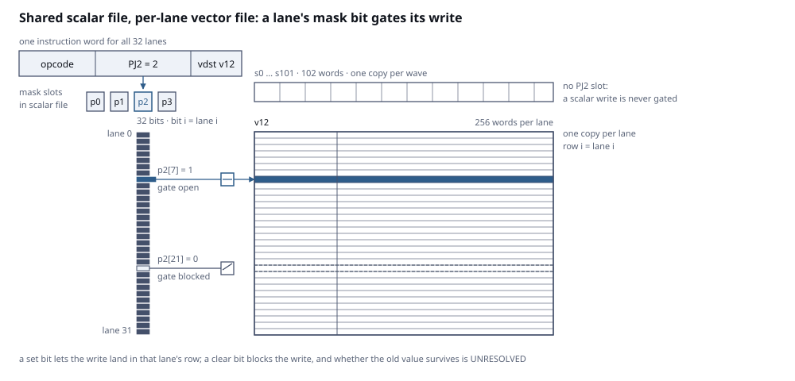

# Execution Model

This chapter describes how a shader executes: the wave, the register files, the
mask mechanism and the order in which a stage starts and ends. Instruction
encoding and per-instruction semantics are in Part V.

The figure shows the lane grid, the per-lane vector file, the per-wave scalar file
and the mask that gates a write.

## Wave and lane

A **wave** is the unit of scheduling. A wave contains up to 32 **lanes**, and
each lane executes one invocation of the shader. All lanes of a wave execute the
same instruction stream; each lane has its own vector registers, while the
scalar registers are shared by the whole wave.

A wave is issued to a vector unit. The vector unit keeps several waves resident
and selects one to issue. The number of waves a unit can hold, the issue width
and the per-instruction latency are not established:

> UNRESOLVED: how many waves a vector unit can keep resident, and how many
> instructions it can issue per cycle.

The 32-lane width is an architectural maximum. A lane mask is one 32-bit word,
so a 33rd lane has no representation; a launch that needs more than 32
invocations uses more than one wave.

## Register files

| File | Size | Visibility | Purpose |
|------|-----:|------------|---------|
| Scalar (SGPR) | 102 registers, `s0..s101` | One copy per wave | Uniform values, descriptors, control flow. |
| Vector (VGPR) | 256 registers, `v0..v255` | One copy per lane | Per-invocation data. |
| Lane mask | 4 registers, `p0..p3` | One bit per lane | Per-instruction lane set. |
| Condition | `SCC` | One bit per wave | Scalar comparison result and carry. |

The low scalar registers are reserved for the launch and for the lane-mask
window; the exact windows are in [Registers and allocation](../shaders/registers.md).
The vector registers are private to a lane: two lanes may hold different values
in the same register number.

## Instruction execution

A shader is a stream of two-word instructions. Each instruction is fetched and
issued for the whole wave. The per-lane operands are read from the vector
registers of each lane; a scalar operand is read once for the wave.

Three properties define the execution model:

1. **Masks, not predicates.** An instruction carries a 2-bit selector that names
   one of `p0..p3`. The instruction executes only on the lanes whose bit is set
   in that register. The selected mask is an absolute lane set; it is not
   intersected with `p0`.
2. **A gated write is suppressed, not cleared.** A lane outside the selected
   mask keeps its previous destination value. Two gated writes with
   complementary masks therefore compose into a per-lane select.
3. **Branches are wave-wide.** A branch tests a scalar condition or a lane-mask
   register as a value. Per-lane control flow is built from compares that write
   a mask, mask manipulation, and branches on the mask. There is no per-lane
   branch and no delay slot.

The mask mechanism is described in [Execution](../isa/execution.md); the
operand encoding of the selector is in [Operands](../isa/operands.md).

## Stage entry and exit

A stage starts at the kernel entry address in its shader-info record. The launch
provides the stage's input registers: vertex index and instance identifier for a
vertex stage, barycentric coordinates and interpolants for a fragment stage, and
the descriptor roots for every stage. The complete list is in
[Registers and allocation](../shaders/registers.md).

Every stage begins by capturing the active lane mask into a scalar register, so
the mask can be restored at an exit that is not a termination. A stage that uses
helper lanes for derivatives installs a whole-quad mask after the capture.

A stage ends in a fixed order:

1. write the stage outputs (SIO writes, or stores through descriptors);
2. commit the export with the export instruction;
3. order pending memory and interface work with the ordering instruction;
4. terminate the invocation.

A discard is not a termination: the shader restores the captured mask, clears
the lanes that must not write, and continues. The ordering instruction and the
terminator are described in the [control family](../isa/families/control.md).

## Divergence

A compare writes a lane mask. A region is entered by narrowing the current mask
and is left by restoring the saved mask. Because a gated write suppresses rather
than clears, the compiler can merge two regions by issuing one gated copy per
region mask.

The mask registers are undefined at launch except for the live mask installed by
the stage prologue. A shader must write a mask before selecting it.

## Synchronisation scopes

| Scope | Mechanism |
|-------|-----------|
| Within an invocation | Instruction order; the ordering instruction for pending memory work. |
| Within a workgroup | Workgroup barrier for shared memory. |
| Between submissions | The submission fence. |
| Host and device | Buffer residency and the completion fence. |

The ordering instruction is not a host fence and does not signal completion. It
orders the work of the current invocation. A barrier is a workgroup rendezvous,
not a global memory fence.

## Interaction with fixed-function blocks

The SP is surrounded by fixed-function blocks. A vertex stage receives fetched
attributes and writes its output to the SIO ring; the rasterizer consumes the
primitive and produces fragment coverage and interpolation coefficients; the
fragment stage reads those inputs and writes colour and depth; the output-merger
blocks apply the depth, stencil and blend state.

The blocks and their state are described in
[Graphics pipeline](../graphics/pipeline.md). The stage interfaces are in
[Stage interfaces](../shaders/stages.md) and [SIO](../shaders/io.md).

## Limits and open questions

| Property | Value |
|----------|-------|
| Wave width | 32 lanes (architectural maximum) |
| Scalar registers | 102 |
| Vector registers | 256 per lane |
| Lane-mask registers | 4 |
| Issue width, dual issue | UNRESOLVED |
| Resident waves per unit | UNRESOLVED |
| Per-instruction latency | UNRESOLVED |
| Number of vector units and their lane counts | UNRESOLVED |
