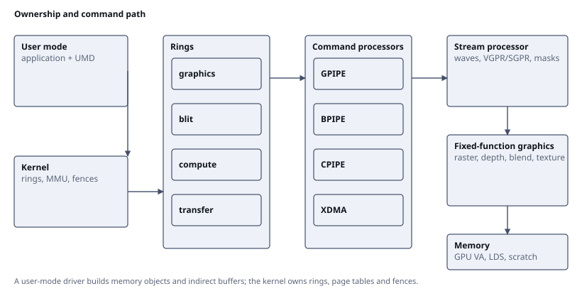

# Architecture Overview

The LG200 is a graphics and compute device: four command processors, a shader
core, fixed-function graphics blocks and a shared memory system. This chapter
names those blocks, follows a graphics and a compute submission to the engine
that executes each, and states which layer owns each ring and queue. Display,
video and kernel-internal scheduling are out of scope. The generation's values
are in the [LG200 profile](generation-lg200.md); the wave and address model are
in [Execution model](execution-model.md) and
[Memory system](memory-system.md).

*The kernel fills the graphics, blit and transfer rings; the compute ring is
client memory, which the client writes and publishes.*

## Blocks

| Block | Fed by | Executes |
|-------|--------|----------|
| GPIPE | The graphics ring | State records in indirect buffers; drives a draw's stages and fixed-function state. |
| BPIPE | Its own ring | 2D copy, fill and blit; no shader. |
| CPIPE | Compute queues | Dispatches from an MCS command stream. |
| XDMA | Its own ring | Copy and fill over linear memory. |
| HIQ | Kernel-written firmware packets | Queue install and removal, doorbells, status. |
| Command port | A register mailbox and direct register writes | Engine enable, ring provisioning, MMU, VMIDs, power. |
| Shader core | Waves from GPIPE and CPIPE | Vector and scalar instructions, masks, texture and memory. |
| Fixed-function graphics | GPIPE | Primitive assembly, rasterization, depth and stencil, blend, texture filtering, streamout, queries. |
| Memory system | Every engine | Page tables, VMIDs, caches, memory interface. |

The ring numbering also defines DPIPE and EPIPE. LG200 has neither block; a
submission that names one is refused.

## Two command paths

A submission is a chunk array. One chunk kind carries an indirect buffer: a GPU
address, a length in bytes and an engine selector. The kernel resolves the
selector, admits the buffer against the submission's residency set, and appends
the packets that point at it; the engine reads everything else from the buffer.
All buffers of one submission must resolve to the same ring.

### Graphics: a ring of pointers

On the graphics ring a chunk becomes a VMID update followed by the
indirect-buffer command (`0x80`), which carries the buffer's address, its length
and the VMID. The processor fetches the buffer through the page directory the
submission installed for that VMID and executes the state records inside it.
Chunks on one ring run in packet order. The kernel never copies the buffer: the
records live in client memory and the ring carries only their address. Ring
packets and buffer contents are different packet sets; the buffer's records are
defined in [State records](../graphics/state-records.md).

### Compute: a queue the client writes

Compute has no indirect-buffer route: the submission path refuses the engine
selector for compute, so no kernel packet leads into CPIPE. The client creates a
queue instead — a power-of-two ring of 4 KiB to 1 MiB, 64-byte aligned, with a
64-byte index block immediately before it. The kernel validates the geometry,
builds the queue descriptor (ring base, length in dwords, PASID, queue id, and
the addresses of the write and read indices) and hands it to the firmware.

The ring carries MCS (micro-code stream) commands, not HSA AQL packets: each
command word holds an opcode in its low byte and a config field above it. A
dispatch is a fixed sequence: the state-configuration command `0x89` writes the
launch parameters into device state, the group command `0x87` carries the three
workgroup counts, and a submit command (`0x8a`) names the 64-bit completion
signal.

The client publishes in two steps: it writes the new write index into the index
block, then asks for a doorbell. The doorbell names only the PASID and the queue
id; the kernel checks the index it is handed against the ring size and 64-byte
alignment, and never parses the stream. The firmware consumes from the write index
and writes the consumed position back to the read index.

### Control is not a data path

Bringing an engine up is not a ring operation. The kernel gives a pipe its ring
base and size as arguments to an immediate command: it writes a command word and
two arguments into a mailbox, raises the command-port interrupt, and polls a
status word until the device reports completion. MMU enable, TLB maintenance and
power-level changes travel the same way, serialised by the one mailbox. A value
that needs no argument, such as a pipe's write pointer, is written straight to a
register.

Configuration that must be ordered against submitted work does appear on the
ring: a register write (`0x81`), a VMID-to-PASID binding (`0x84`), or the
page-directory writes and TLB invalidation a submission emits before its first
buffer. Completion is also a memory write: the last packets store the
submission's sequence number and raise an interrupt. Firmware control is a
separate vocabulary of packets — process mapping, queue installation and removal,
doorbells — written into the HIQ; a client never emits them.

## Ownership

| Object | Written by | Publish point | Pointer location |
|--------|-----------|---------------|------------------|
| Graphics, blit, transfer rings | Kernel | Ring commit | MMIO write-pointer register |
| Ring read pointer | Device | As it consumes | Kernel writeback memory, or a register |
| Compute queue (MCS ring) | Client | The client, then a doorbell | 64-byte index block |
| Indirect buffer | Client | The ring packet naming it | GPU virtual address |
| Queue descriptor | Kernel | A queue-installation packet | HIQ packet payload |

A client never writes a kernel ring cursor: it writes command bytes and submits,
and the kernel stages the complete frame, copies it into the ring, and only then
writes the write-pointer register. On the compute path the split differs: the
client owns the bytes and the index, the kernel owns the queue's existence and
the doorbell, so the correctness of a dispatch is entirely its client's
responsibility.

## A draw is a state record

There is no draw packet. A draw is the 512-dword state block the records have
accumulated, made current by the `0x03` that ends the record. Its own parameters
are a 9-dword structure, Draw Info, at state offset `0x000`;
[Draw](../graphics/draw.md) defines the rest of the block.

A record takes one of two forms:

| Form | Length | Layout |
|------|--------|--------|
| Full | 516 dwords | `0xf04`, `10`, `0x20000001`, 512 state dwords, `0x03` |
| Delta | 4–516 dwords | `0xf04`, one window descriptor per changed run, then `0x03` |

Both are built from window descriptors: bits 7:0 hold the opcode (value `1`, a
state-window write), bits 19:8 the first state dword of the run, bits 31:20 the
run length, whose dwords follow. The full form's `0x20000001` is such a
descriptor with start `0` and length 512. The mode word `10` distinguishes the
full form from a delta; other values do not appear in any stream described here,
and their meaning is UNRESOLVED.

A standalone buffer that carries one full record is 528 dwords: the 516-dword
record, then `0xf05` (command end) and eleven zero dwords. Records inside one
buffer are packed back to back instead: a full record is 516 dwords there, the
cursor advances by the record's own length, and only the last record of the
buffer is followed by `0xf05` and the eleven zero dwords.

Because the state block persists across records, a delta names only what changed.
A driver MUST include every dword whose value changed: a dword the record omits
keeps the value the processor already holds, and a draw that then uses it reads
or writes an address nobody programmed.

Indirect buffers are admitted with 4-byte alignment of address and length, and
nothing stronger. A 32-byte or 64-byte start is a builder convention; whether the
command processor requires more than 4 bytes is UNRESOLVED.
