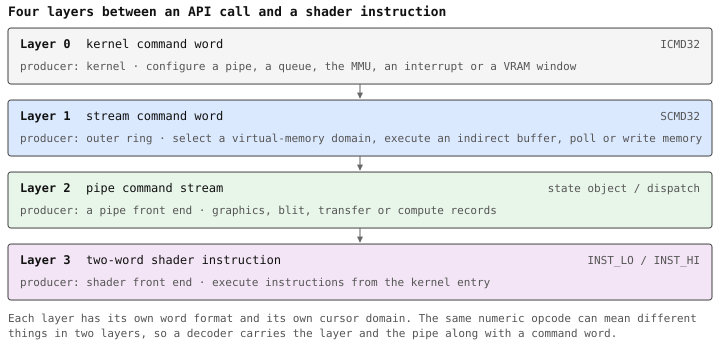
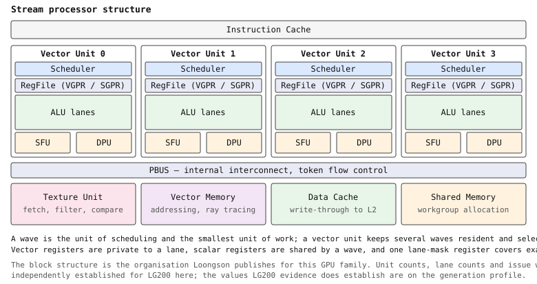

# Execution Model

This chapter describes how work reaches the hardware and how a shader runs.
Values that differ between generations are in the
[generation profile](../chips/lg200.md); terms are defined in the
[glossary](glossary.md).

## Command and execution layers

Four layers sit between an API call and a shader instruction.  Each has its own
word format and its own cursor domain, and the same numeric opcode can mean
different things in different layers:

| Layer | Format | Producer | Role |
|------:|--------|----------|------|
| 0 | kernel command word | kernel | configure a pipe, queue, MMU, interrupt or VRAM window |
| 1 | stream command word | outer ring | select a virtual memory domain, execute an indirect buffer, poll or write memory |
| 2 | pipe command stream | a pipe front end | graphics, blit, transfer or compute records |
| 3 | two-word shader instruction | shader front end | execute instructions from the kernel entry |

A decoder must carry the layer and the pipe along with a command word; the same
value in two layers is two different commands.

## Pipes

A *pipe* is a command-processing engine with its own ring, its own command
vocabulary and its own completion source.  A pipe is provisioned and owned by the
kernel; a user-mode driver reaches it by submitting an indirect buffer and
waiting on a fence, never by programming registers.  The pipes of this
generation, their cursors, their VMID assignment and their completion sources are
tabulated in the [generation profile](../chips/lg200.md#pipes); the per-pipe
command vocabularies are under [Host and Commands](../host/interface.md).

Compute work has a different ownership model from graphics: the kernel creates a
queue, the queue's user ring carries the compute command grammar, and submission
happens through a doorbell on the management ring.  There is no user-visible BAR
doorbell.  [Compute](../host/compute.md) covers the dispatch itself.

## The stream processor

The pipes feed a *stream processor*: the unit that executes shader work.  It holds
several vector units, each with its own scheduler and register file, a bank of
ALU lanes plus special-function, transcendental and tensor units, a texture
block, a workgroup shared-memory block and a data cache, all behind one
instruction cache and the internal bus.

A wave is the unit of scheduling, and the smallest unit of work; a vector unit
keeps several waves resident and selects among them for issue.  This is what makes
the register model what it is: the vector registers are private to a lane, the
scalar registers are shared by a wave, and a lane-mask register is exactly one
wave wide.  [Registers and Allocation](../shader/registers.md) covers the
consequences for a compiler.

The block structure above is the one Loongson publishes for the streaming
processor of this GPU family.  The values that this generation's own evidence
establishes are on the [generation profile](../chips/lg200.md); figures such as
the number of vector units, the issue width and the per-unit lane counts come
from the published description of the family and are not independently
established for LG200 here.  Issue width, dual-issue behaviour and per-instruction
latency are `UNRESOLVED`.

## Shader execution

A shader is a stream of two-word instructions starting at the stage's kernel
entry.  Invocations are grouped into waves; each lane of a wave runs the same
instruction stream over its own registers.

* **Registers.** Each lane has its own vector registers; the scalar registers
  are shared by the wave.  Lane-mask registers carry the set of active lanes as
  data, and the condition register carries a scalar flag.  See
  [Operands and Execution Registers](../isa/operands.md) for the files, the
  reserved windows and the conditional-execution mechanism.
* **Divergence** is expressed through lane masks and branches, not through
  instruction-level predication: a compare writes a mask, a branch reads one, and
  every gated instruction names the mask it runs under.  A gated instruction
  suppresses its write on the lanes outside that mask instead of clearing them,
  so a mask is a per-instruction lane set and not a rewrite of the destination.
  See [Conditional execution](../isa/operands.md#conditional-execution).
* **Entry state.** A stage starts with the launch-provided registers described
  in [Stage Interfaces](../shader/stages.md): vertex index, instance identifier,
  interpolation coordinates, descriptor bases.
* **Exit.** A stage finishes by exporting its outputs through the stage
  interface, ordering pending memory work, and terminating the invocation.  The
  ordering step is what makes prior loads and stores visible before the stage
  completes.

## Memory

All addresses in commands and descriptors are GPU virtual addresses of the
selected domain.  The model has three properties a host must respect:

1. **Explicit residency.** Every range a submission touches must be mapped and
   resident until the submission's fence signals.
2. **No cache-management packets.** There is no flush or invalidate command: a
   CPU read of GPU-written memory happens after the fence, and CPU writes become
   visible through the ordering of the submission that consumes them.
   Host-written resources use write-combined mappings.
3. **Fixed map granularity.** Mappings are page-granular and aligned; an
   indirect buffer must additionally be mapped executable.

## Fixed-function blocks

Between and around the shader stages:

| Block | Function |
|-------|----------|
| Primitive assembly | vertex fetch through attribute descriptors, primitive assembly by the primitive type in Draw Info |
| Rasterizer | viewport transform, guardband clipping, scissor, fill mode, sample coverage |
| Interpolator | supplies barycentric coordinates and an interpolation coefficient table to the fragment stage |
| Depth and stencil | compare, write, polygon offset, stencil operations on both faces |
| Blending | per-target blend with optional logic operation, dual-source and independent modes |
| Texture unit | LOD selection, filtering, wrapping, depth comparison, gather, and format conversion on fetch |
| Streamout | writes generated vertices to buffers through descriptors, driven by the streamout stage record |
| Query unit | occlusion, primitives generated and primitives emitted counters with begin/end packets |

Multisampling exists in one configuration only — 4x — and colour resolve runs as
a GPU pass while depth and stencil resolve run through CPU transfers.  See
[Multisampling](../shader/descriptors.md#multisampling).

## Shader input and output

Stages exchange data through SIO, a channel-addressed interface, and through
descriptor-bound memory.  The stage conventions, the streams and the export and
emit rules are in [Stage Interfaces](../shader/stages.md) and
[SIO](../shader/sio.md).

## Synchronisation

Ordering is established at four different scopes, and none of them substitutes
for another:

| Scope | Mechanism |
|-------|-----------|
| Within an invocation | instruction ordering, and `check`, which orders pending memory work |
| Within a workgroup | barrier |
| Between submissions | the submission's fence |
| Host and device | buffer residency and the completion fence |

## UNRESOLVED

* How many waves a unit can hold.  Whether 32 lanes is an architectural maximum is settled: **32 lanes is an architectural maximum by construction**: the wave lane set is carried in a single 32-bit lane mask - measured, an all-true run gives 0xffffffff while the 4, 8 and 16-lane runs give 0x000f, 0x00ff and 0xffff - so a 33rd lane would have no representation, and the producer .wave_size: 32 agrees with the ceil(lanes/32) group count.  How many waves a unit can hold is a separate question and stays UNRESOLVED.
* Cache hierarchy parameters, sizes and associativity.
* Issue width, dual-issue behaviour and per-instruction latency.
* The number of vector units, their lane counts and the ALU/SFU/DPU/tensor ratio
  of this generation: the published family description states them, and LG200
  evidence does not establish them independently.
* Whether any launch state beyond the documented entry registers is provided.
* The hardware behind a compute queue beyond its exposed interface.
* The decoder and encoder pipes: no launch contract exists for this generation.
