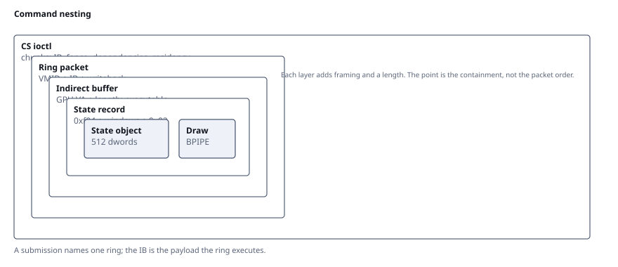

# Draw

A draw is described by one state record. Draw Info selects the primitive
topology, the element source, the element count and the instance count; the rest
of the record carries the fixed-function state the draw uses. This chapter
defines that block, the primitive enum, indexing, instancing, primitive ids and
vertices per patch. There is no separate draw packet: terminating the record
makes its accumulated state the draw's state.

Draw Info is 36 bytes at state offset `0x000`, the first nine dwords of the
512-dword state block. Pipe Enables at `0x030` selects culling, fill mode and the
other rasterization behaviour; it is defined in
[State Object](state-object.md#pipe-enables) and used in
[Rasterization](rasterization.md). The surrounding record is described in
[State records](state-records.md).

## Draw Info

Draw Info is nine dwords at `0x000`; bit 0 is the least-significant bit of the
first dword. The dwords are control, count, instance count, vertices per patch,
vertex offset, restart index, index address low, index address high, primitive id
input.

| Bits | Field | Meaning |
|------|-------|---------|
| `[2:0]` | Index size | Index width in bytes: 0 = none, 2 = 16-bit, 4 = 32-bit. |
| `[11:8]` | Primitive type | Topology; see [Primitive types](#primitive-types). |
| `[16]` | Primitive restart | End the current primitive at Restart Index. |
| `[17]` | Reset primitive id | Restart the primitive-id counter at draw start. |
| `[18]` | Primitive start offset | Raised with Reset primitive id; effect UNRESOLVED. |
| `[63:32]` | Count | Indices if indexed, otherwise vertices. |
| `[95:64]` | Instance count | Number of instances the draw runs. |
| `[127:96]` | Vertices per patch | Constant 3 in every draw; not a topology control. |
| `[159:128]` | Vertex offset | First vertex, or the index bias when indexed. |
| `[191:160]` | Restart index | Index value that ends the current primitive. |
| `[223:192]` | Index buffer low | Low 32 bits of the first index's address. |
| `[255:224]` | Index buffer high | High 32 bits of the first index's address. |
| `[287:256]` | Primitive id input | Programmed zero; effect UNRESOLVED. |

No field is defined for bits 3–7, 12–15 or 19–31 of the first dword; a driver
MUST program them zero.

Count is indices for an indexed draw and vertices otherwise. A strip, loop or fan
is one draw: the topology decides how many primitives the elements form.

## Primitive types

The field is four bits; values 0–13 are defined, 14 and 15 are not and a driver
MUST NOT program them.

| Value | Primitive | Value | Primitive |
|------:|-----------|------:|-----------|
| 0 | Point list | 7 | Quad list |
| 1 | Line list | 8 | Quad strip |
| 2 | Line loop | 9 | Polygon |
| 3 | Line strip | 10 | Line list with adjacency |
| 4 | Triangle list | 11 | Line strip with adjacency |
| 5 | Triangle strip | 12 | Triangle list with adjacency |
| 6 | Triangle fan | 13 | Triangle strip with adjacency |

The adjacency values are programmed as their own topologies; how the rasterizer
consumes their extra vertices is UNRESOLVED.

## Indexing

Index Size is 0 (none), 2 (16-bit) or 4 (32-bit); values 1, 3, 5, 6 and 7 are
undefined and MUST NOT be programmed. With size 0 the draw fetches Count
vertices: element `i` uses vertex `Vertex Offset + i`, received in `v0`. Index
Buffer Low, High and Restart Index are unused and SHOULD be zero; Primitive
Restart MUST be clear.

With size 2 or 4, Index Buffer Low and High are the 64-bit address of the first
index, not the buffer base:

    address = buffer base + byte offset + start * index size

A 16-bit index is zero-extended. The vertex fetch index is the index plus Vertex
Offset, so Vertex Offset is the index bias, and the result is received in `v0`.
The address MUST be at least `0x1_0000_0000`, the user allocator's 4 GiB floor,
and `Count * index size` MUST stay inside the buffer. The host bounds
`start * index size` to 32 bits; whether the hardware has the same limit is
UNRESOLVED.

With Primitive Restart set, each fetched index is compared with Restart Index.
When equal, the current primitive ends and the next index starts a new one. The
bit requires an index buffer and MUST be clear at size 0. A driver MAY instead
split the draw at each restart index: each segment gets its own Draw Info, Count
equal to the run length, the address advanced to the run's first index, and
Primitive Restart clear. A split renumbers primitives: the counter restarts at
each segment, so a later segment must add its base if ids must count across the
draw; see [Primitive id](#primitive-id).

## Instancing

Instance Count is the number of times the vertex stream runs; program at least
one. The vertex stage receives the vertex id in `v0` and the instance id in
`v1`; raise the domain stage config's Input Instance ID bit (`0x4d8`, bit 2)
when the vertex stage reads it. Draw Info has no base-instance field: `v1` starts
at zero for each draw, and a frontend that needs a base instance supplies it
through a shader constant. Vertex Offset changes `v0`, never `v1`.

Per-attribute divisors are not in Draw Info or in the 16-byte buffer descriptor
that describes an attribute. The vertex stage computes a fetch index per
attribute: divisor 0 uses `v0`, divisor 1 uses `v1`, and a divisor above one uses
`v1 / divisor`. Instance-rate attributes therefore do not add Vertex Offset.

## Primitive id

The primitive id numbers the input primitives of the draw. The geometry stage
reads its input id from `v1` at entry; raise the geometry stage config's Input
Primitive ID bit (`0x4e0`, bit 12) when it reads the id. The fragment stage's id
is a geometry-stage export: `gl_PrimitiveID` arrives as a flat varying, so a
fragment shader that reads it requires a geometry stage. The fragment input
record has a Primitive ID Input enable at `0x530` bit 32; no producer raises it,
and whether it can supply the id without a geometry stage is UNRESOLVED.

Reset Primitive ID restarts the counter at the start of the draw; with Primitive
ID Input zero, the first id is zero. The two side-band bits are a pair: a draw
that needs the primitive-id lane raises Reset Primitive ID and Primitive Start
Offset together, and a draw that does not leaves both clear. A geometry stage
that reads the id, and a streamout path that addresses records by it, need that
lane. The effect of Primitive Start Offset alone, and the value Primitive ID
Input would supply, are UNRESOLVED; every draw programs Primitive ID Input zero.

## Vertices per patch

Every draw in this pipeline programs 3 here, for points, lines and triangles
alike. The state interface has a hull stage config and an HS enable bit, so a
tessellated pipeline could give the field meaning, but no draw enables the hull
stage. In such a draw the value is constant: it does not follow the primitive and
is not read from an API patch size, so it cannot describe the draw's topology. It
is a fixed pipeline parameter, not a patch size. Program 3. Why that is the
value, and what a hull stage would make the field mean, are UNRESOLVED.

## Open questions

- The effect of Primitive Start Offset, and what Primitive ID Input would supply.
- Whether the fragment input record's Primitive ID Input enable can deliver an
  id without a geometry stage.
- Why 3 is the value of Vertices per patch, and what it means once a hull stage
  runs.
- How the rasterizer consumes adjacency vertices.
- Whether a restart starts each strip run with a fresh winding phase, for every
  strip topology.
- Whether the hardware bounds `start * index size`, and whether Vertex Offset is
  added modulo 2^32 for a negative bias.