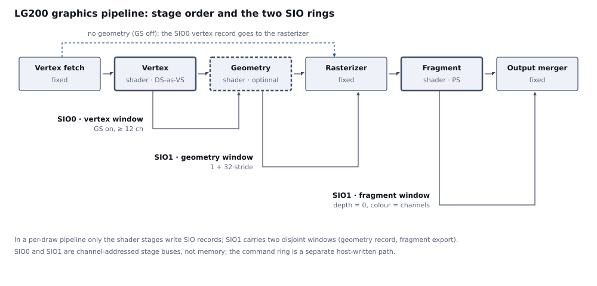

# Graphics Pipeline

A graphics submission turns a draw description into fragments and surface
writes. This chapter fixes the order of the LG200 stages, says which of them run
a program, describes how a program is bound to a stage, and defines what
consecutive stages exchange. Field layouts are in [State object](state-object.md),
the draw description in [Draw](draw.md), vertex attribute binding in
[Vertex input](vertex-input.md), and the export instructions in
[SIO](../shaders/io.md).

The dashed path is a draw without a geometry stage: the SIO0 record goes straight
to the rasteriser. SIO1 carries two disjoint windows, the geometry record and the
fragment export.

## Stage order

A draw passes through six stages. Three of them run a program, and the vertex
program runs in the domain slot rather than the vertex slot.

| # | Stage | Kind | Bound by | Produces |
|--:|-------|------|----------|----------|
| 1 | Vertex fetch | Fixed | Draw Info, attribute table | vertex attributes |
| 2 | Vertex | Programmable, domain slot | Shader Config, Domain Stage Config | SIO0 record |
| 3 | Geometry, optional | Programmable, geometry slot | Shader Config, Geometry Stage Config | SIO1 record |
| 4 | Assembly and rasterisation | Fixed | Draw Info, Pipe Enables, Viewport, Guardband | fragments |
| 5 | Fragment | Programmable, pixel slot | Fragment Input Config, Fragment Output Config, attribute map | SIO1 channels |
| 6 | Output merger | Fixed | Depth Control, stencil faces, Blend Control, Color Buffers | surface values |

The order is fixed, the geometry stage is the only optional programmable stage,
and Draw Info is the whole draw description: 36 bytes at offset 0x000 carrying the
index buffer address, primitive type, count, instance count and vertex offset.
Stage 1 reads the attribute table named by the Attributes root of the Shader Info
record, and the vertex program reads the result from registers. Stage 4 is one
block from the shader's point of view: primitive type, cull and fill modes,
viewport transform and guardband arrive as state, the block clips against
whichever clip and cull planes Pipe Enables selects, and its output is fragments,
not a ring record.

There is no tessellation stage. A hull slot and a hull-stage record type exist in
the encoding, but no state window programs a hull stage and no draw raises its
enable bit, so the domain slot always runs the vertex program.

## Records that select a stage

The state block is 512 dwords. These records select and shape the programmable
stages; the fixed-function ones are in [State object](state-object.md). Offsets
are byte offsets from the start of the block.

| Offset | Width | Record | Purpose |
|-------:|------:|--------|---------|
| 0x4c0 | 8 B | Shader Config | stage enables and geometry primitive category |
| 0x4d8 | 8 B | Domain Stage Config | input and output shape of the domain slot |
| 0x4e0 | 8 B | Geometry Stage Config | invocation count and output shape of the geometry slot |
| 0x4f0 | 2 B × 32 | Fragment Attribute Map | which varying feeds which input window slot |
| 0x530 | 8 B | Fragment Input Config | interpolation window and output enables |
| 0x538 | 4 B | Fragment Output Config | MRT format word, one nibble per target |
| 0x540 | 96 B × 6 | Shader Info | one program record per slot |

Shader Info slots are 0x540 + 0x60 × slot, numbered vertex 0, hull 1, domain 2,
geometry 3, streamout 4, pixel 5. The block persists across draws, so a slot this
draw does not run MUST be written with its disabled value rather than left holding
the previous draw's program; the hull slot is the one exception, and nothing
executes there.

The encoding also defines vertex-stage and hull-stage records, but the block has
no window for either: vertex work is programmed through the domain record. The
block is not fully packed — 16 bytes at 0x4c8, 8 bytes at 0x4e8 and 4 bytes at
0x53c are unassigned. No path writes them, their use is UNRESOLVED, and a driver
MUST NOT write them.

## Shader selection

Shader Config (offset 0x4c0) is an 8-byte record whose low byte enables stages.

| Bit | Field | Effect |
|----:|-------|--------|
| 0 | VS Enable | vertex slot runs the program it holds |
| 1 | HS Enable | hull slot runs the program it holds |
| 2 | DS Enable | domain slot runs the program it holds |
| 3 | GS Enable | geometry slot runs the program it holds |
| 4 | SS Enable | streamout slot runs the program it holds |
| 5 | DS As VS | the domain slot runs the vertex program |
| 6 | DS Includes GS | named for a fused domain and geometry program; UNRESOLVED |
| 7 | VS Includes HS | named for a fused vertex and hull program; UNRESOLVED |

A vertex-only draw programs DS Enable and DS As VS and leaves VS Enable clear; the
domain record gives that slot its position size, total size and attribute count. A
draw with a geometry stage adds GS Enable and still leaves VS Enable clear: the
vertex program runs in the domain slot, which feeds the geometry slot instead of
the rasteriser. There is no separate vertex path into the geometry slot, so the
domain slot is the only way a vertex program reaches the geometry stage.

There is no pixel enable bit. The fragment stage runs for every draw, and a draw
that must not write colour does so through its export rather than by disabling the
stage.

GS Primitive Type (bits 12..15) is a category, not an assembly mode: 1 selects
points, 2 lines, 3 triangles, and a strip and a fan share the triangle category. A
geometry program whose output topology is outside those categories cannot be
programmed. The record also carries DS Primitive Type (bits 16..17), DS Point Mode
(18), DS Clockwise (19) and DS Spacing (20..21); no draw programs them and their
effect is UNRESOLVED.

### The vertex slot

The vertex slot does not execute the vertex program, but it is not dead state. The
command processor takes the vertex slot's kernel entry as an instruction-fetch
address even when the slot does not run, so an all-zero record points that fetch at
address 0 — below the client virtual base and unmapped — and the submission is lost
to the fault. The vertex slot carries a copy of the vertex program's record so that
the fetch finds real code; its roots are read only by a launch, so a copy whose
roots are a few draws old is harmless while every address stays mapped. Whether a
launch can start from the vertex slot at all is UNRESOLVED.

The slots a draw does not run are written as all-zero records, so their kernel
entries are 0. Whether the command processor fetches through one of those is
UNRESOLVED; the vertex slot is the one slot the state fills with real code, because
that is the fetch the state is known to have to survive.

### Streamout

Transform feedback has two paths in the encoding. The direct one has no stage of
its own: the vertex or geometry stage writes each record into the target buffer
itself, using the stride and offset the streamout descriptors supply. The second
is a shader-type-6 program in slot 4, enabled by SS Enable, which would copy
per-vertex payload records from the argument buffer into the target buffer through
the descriptor at its RW Buffer root, with a record count and a stride read from a
control pair. Its declared record shape is: only the RW Buffer root hydrated, the
record capacity in argument 2, and 0x20 in the slot tail. A draw that uses the
direct path writes slot 4 as a disabled record and leaves SS Enable clear. What a
slot-4 program does when SS Enable is raised is UNRESOLVED, as is what the tail
dword encodes; the direct path depends on neither. The buffer path is in
[Streamout](streamout.md).

## Stage interfaces

Stages exchange data through the SIO rings and through descriptor-bound memory.
Uniform buffers, storage buffers, images and samplers are reached through
descriptor tables rooted in the Shader Info record; that mechanism is in
[Descriptors](../shaders/descriptors.md).

### SIO rings

SIO0 carries the vertex record: the vertex stage writes it and the geometry stage
or the rasteriser reads it. SIO1 carries the geometry record, one per emitted
vertex and read by the rasteriser, and separately the fragment stage's output
channels, which the output merger reads.

The ring is not an operand. The `SIO0` and `SIO1` of the assembly syntax is a
format-wide mode bit at bit 22 of the instruction's high word, so the instruction
form chooses the ring and no register does. A transfer names the channel window it
covers with a 12-bit channel count, and an export adds the window's base channel.
There is no address operand: a ring is addressed by channel number only.

Three constraints follow:

- The SIO1 ring is 4096 channels. A producer MUST NOT program a wider window; the
  geometry stage's thread count underflows and the rasteriser is left waiting on a
  ring that never completes.
- The geometry stage's input window is the vertex stage's SIO0 width, not its own.
  The domain record's total size MUST equal the width the vertex program exports,
  including the distance payload, and its attribute count is that width divided by
  four. A vertex program that publishes no export width gets (varyings + 2) × 4
  channels, with a floor of 12.
- A vertex stage that feeds a geometry stage writes SIO0 without a closing export
  instruction, and the geometry stage reads the ring directly. A vertex stage that
  feeds the rasteriser ends with an SIO0 export whose channel count is its window
  width.

### Fragment input window

The fragment stage does not read a ring. The rasteriser writes interpolated inputs
into a packed register window that Fragment Input Config names: a 16-bit input
address, a 16-bit input enable mask, a coefficient count, and the output enables
for depth, stencil, coverage mask and sample mask. The Fragment Attribute Map then
says, per window attribute, which varying it carries, whether the rasteriser
generates it, and whether it is a sprite coordinate. The numbering a consumer sees
is therefore a host-side mapping onto a producer's ring slots: two sides agree only
when they key the same varying set, and a mismatch shifts every attribute after the
first difference.

## Fragment components

The fragment stage's SIO1 exports are packed, not per-target slots. Each export
names a window base, a channel count, and the channel inside the window that the
instruction writes. The base is carried in the 16-bit immediate multiplied by 128,
so one reserved channel is 0x80 and two are 0x100.

Channel 0 is reserved in this order: the written fragment depth (one channel), then
the coverage or sample mask (one channel), then colour target 0, target 1 and so
on. A stage that writes depth and no coverage starts colour at 0x80, one that
writes both starts at 0x100, and one that writes neither starts at 0. The
reservation is a property of the shader, not of instruction order: a colour store
may precede the depth store and the colour base still accounts for the depth
channel.

Each colour target contributes its own channel count and the next target starts
after it.

| Target class | Channels | Note |
|--------------|---------:|------|
| packed 8-bit or integer | 1 | one channel per target |
| 16-bit float | 2 | four components, two packed per channel |
| 32-bit float, component count published | 1, 2 or 4 | R32F one, RG32F two, RGBA32F four |
| 32-bit float, component count not published | 4 | the whole register is exported |

A 32-bit format is not automatically four channels: the count follows the target's
component count, so a multi-target draw of R32F attachments packs them one channel
apart, and a mixed draw continues from the accumulated count, which starts a
two-channel target after a packed one at 0x80.

A fragment stage with no colour output still performs a one-channel SIO1 export and
writes no colour channel. That export is the completion signal the output merger
waits for; a stage that omits it leaves the merger waiting.

## Open questions

- Which lanes the rasteriser treats as auxiliary — running the fragment program
  without writing a surface — and whether such a lane still writes SIO1, is
  UNRESOLVED. A shader MUST NOT depend on either behaviour.
- The effect of DS Includes GS (bit 6) and VS Includes HS (bit 7) is UNRESOLVED. No
  state sets either bit, and nothing describes what the command processor does when
  they are set.
- A geometry stage that emits no vertex leaves SIO1 empty. Whether the rasteriser
  then completes the draw or waits for a record is UNRESOLVED.