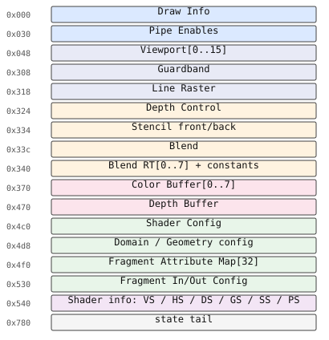

# The State Object

One graphics submission carries one 512-dword state object.  This chapter is the
map of that object: what each block is, which values are established, and which
areas no producer writes.

The map above is generated from the table below, so the two cannot disagree.  It
draws every block, including the regions nothing writes, because knowing which
regions are unassigned is as much use to a driver as knowing the rest.

State offsets are relative to the first dword of the object.  The packet byte
offset is the state offset plus the 0x0c bytes of the
[envelope](../host/graphics-submission.md) header.

## State map

| State offset | Size | Block | Written by a working path |
|-------------:|-----:|-------|---------------------------|
| `0x000` | 0x24 | [Draw Info](#draw-info) | yes, per draw |
| `0x024` | 0x0c | draw tail | never |
| `0x030` | 0x0c | [Pipe Enables](#pipe-enables) | yes, per draw |
| `0x03c` | 0x0c | pipe tail | never |
| `0x048` | 16 x 0x2c | [Viewport](#viewport-and-guardband) | index 0 only |
| `0x308` | 0x10 | [Guardband](#viewport-and-guardband) | yes, per draw |
| `0x318` | 0x0c | Line Raster | yes, per draw |
| `0x324` | 0x10 | [Depth Control](#depth-stencil-and-blend) | yes, per draw |
| `0x334` | 0x04 | Stencil, front | yes, per draw |
| `0x338` | 0x04 | Stencil, back | yes, per draw |
| `0x33c` | 0x04 | Blend Control | yes, per draw |
| `0x340` | 8 x 0x04 | Blend per render target | up to the attachment count |
| `0x360` | 0x10 | Blend constants | yes, per draw |
| `0x370` | 8 x 0x20 | [Color Buffer](#surface-records) | up to the attachment count |
| `0x470` | 0x20 | [Depth Buffer](#surface-records) | when a depth surface is bound |
| `0x490` | 0x30 | pipeline configuration | never |
| `0x4c0` | 0x08 | [Shader Config](#shader-config) | yes, per draw |
| `0x4c8` | 0x08 | Vertex stage config | never |
| `0x4d0` | 0x08 | Hull stage config | never |
| `0x4d8` | 0x08 | Domain stage config | yes (the ordinary vertex role) |
| `0x4e0` | 0x08 | Geometry stage config | when geometry runs |
| `0x4e8` | 0x08 | Streamout stage config | field meanings UNRESOLVED |
| `0x4f0` | 32 x 0x02 | Fragment attribute map | all 32 entries |
| `0x530` | 0x08 | Fragment input config | yes, per draw |
| `0x538` | 0x04 | Fragment output config | yes, per draw |
| `0x53c` | 0x04 | fragment tail | never |
| `0x540` | 0x60 | Shader info, slot 0 (VS) | never |
| `0x5a0` | 0x60 | Shader info, slot 1 (HS) | never |
| `0x600` | 0x60 | Shader info, slot 2 (DS) | yes |
| `0x660` | 0x60 | Shader info, slot 3 (GS) | when geometry runs |
| `0x6c0` | 0x60 | Shader info, slot 4 (SS) | when streamout runs |
| `0x720` | 0x60 | Shader info, slot 5 (PS) | yes |
| `0x780` | 0x80 | state tail | never |

The state object starts zeroed; blocks that are never written are therefore all
zero, and a consumer must not read meaning into them.

Two consequences of the map are worth stating explicitly.  First, the ordinary
vertex role is carried by the **domain** slot with `DS_AS_VS` set, not by the
VS slot.  Second, viewport records are 0x28 bytes with a four-byte gap between
them, and only viewport 0 is consumed by the established path.

## Draw Info

36 bytes at `0x000`.

| Bits | Field | Values |
|-----:|-------|--------|
| `[2:0]` | Index size | 0 = no index buffer, 2 = 16-bit, 4 = 32-bit |
| `[11:8]` | Primitive type | see the primitive table |
| `[16]` | Primitive restart | enable |
| `[17]` | Reset primitive id | reset at draw start |
| `[18]` | Primitive start offset | start mode |
| `[63:32]` | Count | elements or vertices |
| `[95:64]` | Instance count | |
| `[127:96]` | Vertices per patch | written as 3 for the ordinary vertex role |
| `[159:128]` | Vertex offset | first-vertex or index bias |
| `[191:160]` | Restart index | |
| `[255:192]` | Index buffer low | GPU VA low word |
| `[287:256]` | Index buffer high | GPU VA high word |
| `[319:288]` | Primitive id input | written as 0 unless the geometry stage seeds it |

### Primitive types

| Value | Primitive | Value | Primitive |
|------:|-----------|------:|-----------|
| 0 | point list | 1 | line list |
| 2 | line loop | 3 | line strip |
| 4 | triangle list | 5 | triangle strip |
| 6 | triangle fan | 7 | quad list |
| 8 | quad strip | 9 | polygon |
| 10 | line list adjacency | 11 | line strip adjacency |
| 12 | triangle list adjacency | 13 | triangle strip adjacency |

## Pipe Enables

12 bytes at `0x030`.

| Bits | Field | Meaning |
|-----:|-------|---------|
| `0` | Flat shade | flat interpolation mode |
| `1` | Flat shade first | provoking vertex selection |
| `2` | Pipe count | participates in the query and streamout pipe count; it does **not** skip rasterization |
| `3` | Line stipple | stipple enable |
| `[5:4]` | Front/back cull | face culling |
| `[7:6]` | Early Z / hi-Z | depth controls |
| `8` | Front CCW | winding convention |
| `9` | Bottom edge rule | raster rule |
| `[11:10]` | Raster order | selector |
| `[13:12]` | Fill front | 0 = fill, 1 = line, 2 = point |
| `[15:14]` | Fill back | same |
| `[18:16]` | Y controls | flip Y, coordinate Y, invert vertex Y |
| `19` | Sprite origin | sprite coordinate origin |
| `[22:20]` | Polygon offset enables | point, line, fill |
| `23` | Window rectangle mode | |
| `[25:24]` | Edge flag | flag and enable |
| `26` | Fixed point size | fixed point size control |
| `27` | Stencil write | participation |
| `[30:28]` | MRT count | attachment count minus one |
| `[47:32]` | Clip and cull plane enable | masks |
| `48` | MSAA enable | set for a 4x draw; the sample count is not stored elsewhere |
| `[51:49]` | Smooth modes | line, point, polygon |
| `[55:52]` | Raster scan | written as 1 |
| `[57:56]` | Sample rate | selector |
| `60` | Integer coordinates | pixel-centre integer mode |
| `[75:64]` | Layer | render-layer value |
| `[79:76]` | Viewport index | selector |
| `[81:80]` | Layer/viewport enable | system outputs |

The winding convention interacts with the viewport: the effective front-face
direction is the `Front CCW` bit xored with the sign of the Y viewport scale and
the `Flip Coordinate Y` control.

## Viewport and guardband

A viewport record is 40 bytes at `0x048 + 0x2c * n`:

| Offset | Size | Field |
|-------:|-----:|-------|
| `+0x00` | 4 | X scale |
| `+0x04` | 4 | X offset |
| `+0x08` | 4 | Y scale |
| `+0x0c` | 4 | Y offset |
| `+0x10` | 4 | Z scale |
| `+0x14` | 4 | Z offset |
| `+0x18` | 2 | scissor minimum X |
| `+0x1a` | 2 | scissor maximum X |
| `+0x1c` | 2 | scissor minimum Y |
| `+0x1e` | 2 | scissor maximum Y |
| `+0x20` | 4 | depth minimum |
| `+0x24` | 4 | depth maximum |

The guardband at `0x308` holds four float patterns: minimum X, maximum X,
minimum Y, maximum Y.

A degenerate scissor (an empty range) is how a state object is told to produce
no fragments; it is not an error.

## Line raster

12 bytes at `0x318`: a stipple factor, a 16-bit stipple pattern, a point size in
quarter pixels and a line width in quarter pixels.

## Depth, stencil and blend

Depth Control is 16 bytes at `0x324`: polygon offset units, factor and clamp as
float patterns, then a depth enable byte, a depth write byte, a near/far clamp
enable byte and a compare function byte.  The compare function is
never=0, less=1, equal=2, less-equal=3, greater=4, not-equal=5, greater-equal=6,
always=7.

Each stencil face record is 4 bytes at `0x334` (front) and `0x338` (back):
enable in bit 0, compare function in `[3:1]`, fail operation in `[6:4]`,
depth-pass operation in `[9:7]`, depth-fail operation in `[12:10]`, a value
mask byte, a write mask byte, and the stencil **reference value** in
`[119:112]`.  Stencil operations are keep=0, zero=1, replace=2,
increment-clamp=3, decrement-clamp=4, increment-wrap=5, decrement-wrap=6,
invert=7.

Blend Control is 4 bytes at `0x33c`: independent per-target blend in bit 0,
dual-source blend in bit 1, logic-op enable in bit 3, and the logic operation in
`[7:4]`.  When independent blending is clear, the first target's blend word is
used for every attachment.

Each blend word at `0x340 + 4 * n` holds a blend enable, a 3-bit RGB equation,
5-bit RGB source and destination factors, a 3-bit alpha equation, 5-bit alpha
source and destination factors, and a 4-bit write mask.  Equations are add=0,
subtract=1, reverse-subtract=2, minimum=3, maximum=4.

Blend constants at `0x360` are four float patterns.

## Surface records

Colour attachments live at `0x370 + 0x20 * n` and the depth attachment at
`0x470`; both are the same 32-byte record.

| Bits | Field | Notes |
|-----:|-------|-------|
| `[63:0]` | Base address | raw byte address, no shifted encoding |
| `[71:64]` | Hardware format | see [formats](../shader/descriptors.md#color-hardware-formats) |
| `[75:72]` | Type | surface type enum |
| `[79:76]` | Tiling mode | 0 = linear, 2 = tile2 |
| `[91:80]` | Swizzle | 12-bit channel swizzle for colour; not present on depth records |
| `[92]` | Swizzle reverse | not used |
| `[93]` | Power-of-two pad | set for a padded layout |
| `[111:96]` | Width | extent, not extent minus one |
| `[127:112]` | Height | extent, not extent minus one |
| `[143:128]` | Depth | written as 1 for the established 2D path |
| `[159:144]` | Pitch | row span in **elements** |
| `[171:160]` | Base layer | 12-bit first layer |
| `[183:172]` | Last layer | 12-bit last layer |
| `[187:184]` | Base level | written as 0 |
| `[191:188]` | Last level | last mip level of the view |
| `[195:192]` | Level | level of this attachment |
| `[199:196]` | Alignment | mip chain alignment code |
| `[223:200]` | — | no fields |

Surface records follow the layout rules in
[Layout and tiling](../shader/descriptors.md#layout-and-tiling); the pitch field
repeats the level's element stride, and the base address already includes the
offset of the attached level for a non-layered attachment.

Base and last layer are written only for layered attachments — cube faces,
layered arrays and multisample arrays.  Whether the base layer is an offset
relative to the base address or an independent bound is UNRESOLVED: a layered
attachment also relocates its base address, while a cube face does not.

Alignment codes that are established: a mip-mapped cube face writes the base-2
logarithm of the level pitch; a 4x multisample attachment and every depth
attachment write 6.  For the multisample and depth cases the code is unrelated
to the pitch, so the field cannot be a plain `log2(pitch)` in all cases; its
general meaning is UNRESOLVED.

## Shader config

8 bytes at `0x4c0`.

| Bits | Field | Established value |
|-----:|-------|-------------------|
| `0` | Vertex stage enable | 0 |
| `1` | Hull stage enable | 0 |
| `2` | Domain stage enable | 1 |
| `3` | Geometry stage enable | 1 when geometry runs |
| `4` | Streamout stage enable | 1 when streamout runs |
| `5` | Domain as vertex | 1 |
| `6` | Domain includes geometry | 0 |
| `7` | Vertex includes hull | 0 |
| `[15:12]` | Geometry primitive type | follows the geometry output primitive |
| `[17:16]` | Domain primitive type | tessellation mode |
| `18` | Domain point mode | |
| `19` | Domain clockwise | winding |
| `[21:20]` | Domain spacing | tessellation spacing |
| `[42:32]` | DT maxima | layout is not closed |
| `[58:48]` | TT maxima | layout is not closed |

## Stage configs

The domain stage config at `0x4d8` describes the ordinary vertex role's inputs
and output packing; the geometry stage config at `0x4e0` describes invocations,
stream count, maximum threads, input and output identifiers, vertex count,
stride and the total and per-attribute output sizes.  Their field layouts are
not closed beyond those roles.

The vertex and hull stage configs at `0x4c8` and `0x4d0` are never written by
the established path, and the streamout stage config at `0x4e8` has a slot whose
field meanings are UNRESOLVED.

## Fragment state

The fragment attribute map at `0x4f0` holds 32 two-byte entries: attribute
identifier in `[4:0]`, a generated flag in bit 5 and a sprite-texture flag in
bit 6.  All 32 entries are written even when only some attributes are enabled.

The fragment input config at `0x530` holds an input base address in `[15:0]`,
a per-input enable mask in `[31:16]`, system-output enables for primitive id,
stencil, depth, vmask and sample mask, an interpolation coefficient count in
`[43:36]`, and a scalar-initialization alignment bit.

The fragment output config at `0x538` is a single MRT format word: one format
when a single target is bound, or four bits per target when several are bound.

## UNRESOLVED

* The draw, pipe, pipeline-configuration, fragment and state tails: no
  established meaning.
* Viewports 1..15: the record shape is known but no path fills them.
* The streamout stage config fields.
* The DT and TT maxima layouts inside the shader config.
* The alignment code of a surface record, other than the two established cases.
* The 12-bit colour swizzle subfields.
* Whether the base layer is an offset or a bound.
* Tiling values other than 0 and 2.
* Surface types 2 and 6.
