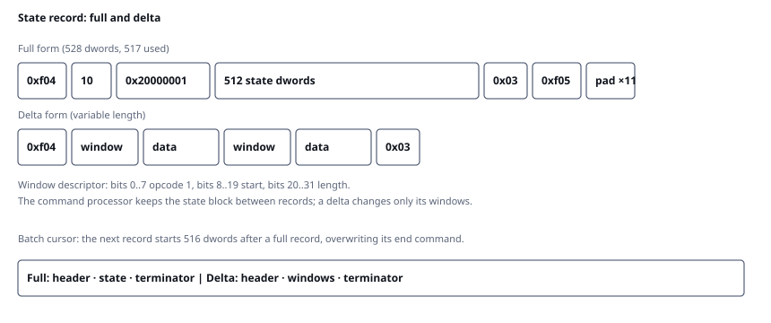

# State Records

A state record is how a graphics command stream applies state: a header, one or
more write windows over a 512-dword state block, and a terminator. The record is
the draw. There is no separate draw packet, and the draw's own fields are the
36-byte Draw Info record at state offset `0x000`.

The full form writes all 512 dwords; the delta form writes only the runs that
changed since the previous record in the same buffer, so its length tracks the
change rather than the block. Fields are in [State object](state-object.md); the
buffer and its border-table preamble are in
[Indirect buffers](../host/indirect-buffers.md).



The full form, the delta form, and the slot each record's end command would take.

## Record grammar

Neither form carries a length field: a record ends where its terminator appears,
and a window list is read until then.

**Full form**, 516 dwords:

```text
0x0000_0f04        record opcode
10                 full-state mode, decimal
0x2000_0001        range: window opcode 1, start 0, length 512
state[0..511]      the 512-dword block
0x0000_0003        terminator
```

**Delta form**, 4 to 516 dwords:

```text
0x0000_0f04        record opcode
<descriptor>       window descriptor
<data>             one dword per state dword in the window
...                further windows, if any
0x0000_0003        terminator
```

A window descriptor is one dword:

| Bits | Field | Meaning |
|------|-------|---------|
| `[7:0]` | Opcode | 1 for a state window. |
| `[19:8]` | Start | First state dword covered by the window. |
| `[31:20]` | Length | Number of state dwords in the window. |

The full form's range word has the same encoding: start 0, length 512 is exactly
`0x2000_0001`. The mode word separates the forms, because 10 is not a legal
window opcode; a delta begins with a descriptor whose low byte is 1.

## Semantics

State dword *n* sits at byte `12 + 4n` from the record's first dword, because the
header is three dwords.

The block persists between the records of one buffer. A full record replaces all
512 dwords; a delta leaves every dword it does not name at the value the previous
record left. The terminator applies the record: writes accumulate over the block,
and the terminator makes that block the draw's state.

The full form is the only one that can establish the block from nothing, so every
buffer here opens with one. Whether the block survives a buffer boundary is
UNRESOLVED; a buffer that opened with a delta would rely on state no record of it
established, and a dropped block renders with stale state and no error.

## Terminator and end command

The terminator is `0x0000_0003`: the packet vocabulary's Submit command, with bits
`[31:8]` a variant-flags field that every terminator here leaves zero. What those
flags select is UNRESOLVED. The terminator is the record's last dword.

The end command is `0x0000_0f05`, one dword: it closes the block it follows, and
the last one in a buffer ends that buffer's stream. Eleven zero dwords follow it,
and zero is the No Operation word. The command processor fetches ahead of the
declared end, so the bytes behind it must be mapped.

The submitted length MUST reach the end command of the buffer's last record. A
length that stops at that record's terminator carries no end command, and the
submission never retires.

The border-table preamble is a six-dword block with `0x0000_0f05` at its fourth
dword: it closes itself and the record behind it still executes. A state record is
followed by an end command only as the buffer's last record.

## Batching

A full record advances the cursor by 516: its terminator is at dword 515, and the
slot at 516 holds the end command in a single-record buffer. In a batch that slot
carries the next record's opcode or the buffer's end command. A delta advances by
its own length, terminator included.

A full record MAY appear anywhere in a buffer, not only first; it is the fallback
whenever a host cannot state the change as a delta. **Host policy**: a batch
accepts at most 516 dwords per record, or the 528-dword single-record envelope.

## Validity rules

- A record MUST start with `0x0000_0f04` as its first dword.
- A full record MUST carry `10` at its second dword and `0x2000_0001` at its
  third, then the 512 state dwords.
- A window record MUST place a descriptor directly after the opcode. Every
  descriptor's low byte MUST be 1, so a window record never carries the mode word.
- A window MUST have a nonzero length, and start plus length MUST NOT exceed 512.
- A record MUST end with `0x0000_0003` and MUST NOT carry padding: the terminator
  follows the last data dword of the last window directly.
- A record MUST lie wholly inside its buffer.

The submission path does not parse a record; it admits a buffer by address, length,
mapping and residency only. A record that breaks these rules reaches the command
processor, and its response is UNRESOLVED.

## Open questions

- The mode word's meaning beyond 10.
- Whether the full form accepts a range other than start 0, length 512.
- Whether a delta may open a buffer: whether the block survives a buffer boundary.
- What the terminator's variant flags, bits `[31:8]`, select.
- Whether a record may be longer than 516 dwords.
- Whether a record-carrying buffer may end at the end command, with no zero dwords
  behind it.
