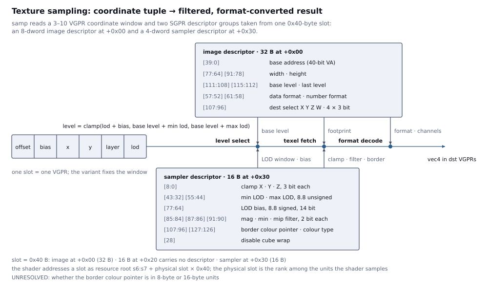

# Texture and Sampling

The texture unit reads an image through an image descriptor and a sampler
descriptor, selects a mip level, filters the samples and converts the result to
the shader's destination format. This chapter defines the descriptors, the
coordinate tuples, the level-of-detail rules and the sampling behaviour.



The figure shows the path from the coordinate tuple to the filtered and converted
result, with the sampler and image descriptors feeding it.

## Binding slot

An image and its sampler share a 0x40-byte slot:

| Offset | Size | Content |
|-------:|-----:|---------|
| `+0x00` | 32 | Image descriptor. |
| `+0x20` | 16 | Not part of a descriptor. |
| `+0x30` | 16 | Sampler descriptor. |

The image-and-sampler root is `s6:s7`. A shader selects a slot by adding the
slot index times 0x40 to the root.

## Image descriptor

The image descriptor is 32 bytes.

| Bits | Field | Meaning |
|------|-------|---------|
| `[39:0]` | Base address | GPU virtual address of the image. |
| `[51:40]` | Minimum LOD | Not used by the current path. |
| `[57:52]` | Data format | Image data format. |
| `[61:58]` | Number format | UNORM, SNORM, UINT, SINT, float, sRGB. |
| `[63:62]` | Memory type low | Not used. |
| `[77:64]` | Width | Base-level width in texels. |
| `[91:78]` | Height | Base-level height in texels. |
| `[94:92]` | Performance mode | Constant 4 in the current path; meaning UNRESOLVED. |
| `[95]` | Interlaced | Not used. |
| `[98:96]` | Destination select X | Channel selector. |
| `[101:99]` | Destination select Y | Channel selector. |
| `[104:102]` | Destination select Z | Channel selector. |
| `[107:105]` | Destination select W | Channel selector. |
| `[111:108]` | Base level | First mip level of the view. |
| `[115:112]` | Last level | Last mip level of the view; for a 4x image, the base-2 logarithm of the sample count. |
| `[120:116]` | Tiling index | 0 linear, 2 tile2. |
| `[121]` | Power-of-two pad | Set for a padded layout. |
| `[122]` | Memory type high | Not used. |
| `[123]` | Texture flip Y | Not used. |
| `[127:124]` | Type | Image type. |
| `[140:128]` | Depth | Base-level depth for a 3D image. |
| `[154:141]` | Pitch | Row span in elements. |
| `[172:160]` | Base array | First array layer. |
| `[185:173]` | Last array | Last array layer. |
| `[203:192]` | Minimum LOD warning | Not used. |
| `[211:204]` | Counter bank id | Not used. |
| `[212]` | LOD hardware count | Not used. |
| `[213]` | Compression enable | Not used. |
| `[214]` | Alpha is MSB | Not used. |
| `[215]` | Colour transform | Not used. |
| `[219:216]` | Lost alpha bits | Not used. |
| `[223:220]` | Lost colour bits | Not used. |

A non-array image descriptor carries one level: the base address includes that
level's offset, base level is 0, and last level is the number of levels minus
one. An array or cube descriptor carries the full mip chain: base and last level
span the chain, the base address is not level-adjusted, and the layer is reached
through the array stride.

## Sampler descriptor

The sampler descriptor is 16 bytes.

| Bits | Field | Meaning |
|------|-------|---------|
| `[2:0]` | Clamp X | Wrap mode for S. |
| `[5:3]` | Clamp Y | Wrap mode for T. |
| `[8:6]` | Clamp Z | Wrap mode for R. |
| `[11:9]` | Maximum anisotropy | Base-2 logarithm of the ratio. |
| `[14:12]` | Depth compare function | Compare function, or 0 for no comparison. |
| `[15]` | Force unnormalized | Use texel coordinates. |
| `[18:16]` | Anisotropy threshold | Not used. |
| `[19]` | Coordinate truncate | Not used. |
| `[20]` | Force degamma | Not used. |
| `[26:21]` | Anisotropy bias | Not used. |
| `[27]` | Truncate coordinates | Not used. |
| `[30:29]` | Filter mode | Not used. |
| `[31]` | Compatibility mode | Not used. |
| `[43:32]` | Minimum LOD | Unsigned 8.8 fixed point. |
| `[55:44]` | Maximum LOD | Unsigned 8.8 fixed point. |
| `[59:56]` | Performance mip | Not used. |
| `[63:60]` | Performance Z | Not used. |
| `[77:64]` | LOD bias | Signed 8.8 fixed point. |
| `[83:78]` | Secondary LOD bias | Not used. |
| `[85:84]` | Magnification filter | Nearest or linear. |
| `[87:86]` | Minification filter | Nearest or linear. |
| `[89:88]` | Z filter | Not used. |
| `[91:90]` | Mip filter | None, nearest or linear. |
| `[92]` | Mip point preclamp | Not used. |
| `[93]` | Disable LSB ceil | Not used. |
| `[94]` | Filter precision fix | Not used. |
| `[95]` | Anisotropy override | Set when the ratio is greater than one. |
| `[107:96]` | Border colour pointer | 12-bit index into the border table. |
| `[124:108]` | Reserved | Zero. |
| `[125]` | Upgraded depth | Not used. |
| `[127:126]` | Border colour type | Table entry type. |

The wrap modes are repeat 0, mirror repeat 1, edge 2, mirror edge 3 and border 6.
The compare functions are the eight values in
[Depth and stencil](depth-stencil.md).

The LOD fields are 8.8 fixed point and express 0 to about 16. A host MUST clamp
a wider range before packing. A mip filter of "none" makes the sampler
single-level: write zero minimum and maximum LOD and select the nearest mip
filter.

The sampler's bit 28 is **Disable Cube Wrap**: setting it disables the seamless
cube edge filter. The current driver derives it from the API's seamless-cube
capability.

## Coordinate tuples

A sampling instruction reads a window of vector registers. The window is an
upper bound; the variant consumes a prefix. The tuple slots are ordered:

1. texel offset, when the variant has one;
2. LOD bias, when the variant has one;
3. coordinates: `(u, v)` for 2D, `(u, v, layer)` for a 2D array,
   `(u, v, w)` for a volume, `(u, v, ref)` for a depth comparison, and a
   direction `(x, y, z)` for a cube;
4. gradients or the explicit LOD, when the variant has them.

| Variant family | Slots after the coordinates |
|----------------|-----------------------------|
| `samp` | None. |
| `samp_b` | Bias before the coordinates. |
| `samp_l` | Explicit LOD. |
| `samp_d` | Two gradient pairs. |
| `samp_o` | Offset before the bias and coordinates. |
| `gather` | Four texels of a 2x2 block; optional offset. |

The offset is a signed six-bit X/Y/Z displacement packed into one dword. A
sampling offset has a range of -8 through 7; a gather offset has a range of -32
through 31.

> UNRESOLVED: whether the bias and depth-reference slots have the same
> per-quad granularity as the offset.

## Level of detail

The sampler selects a level from the shader's LOD, the sampler bias and the
sampler's min/max window:

```text
level = clamp(LOD + bias, base_level + min_lod, base_level + max_lod)
```

The min and max LOD fields are relative to the descriptor's base level. The bias
is not shifted by the base level. An explicit-LOD sampling instruction supplies
the LOD; an implicit sampling instruction derives it from the quad's
derivatives; a gradient form supplies the derivatives explicitly.

An array or cube descriptor keeps the original mip indices, so the LOD domain is
offset by the view's first level. A mip filter of "none" bypasses the LOD
ladder and behaves as a non-mipmapped filter.

## Filtering

| Field | Values |
|-------|--------|
| Magnification | Nearest, linear. |
| Minification | Nearest, linear. |
| Mip | None, nearest, linear. |

Anisotropic filtering is encoded but not implemented: the ratio and override
bits are written, and sampling stays isotropic. The API capability is not
advertised.

## Wrap and border

Wrap modes apply per axis. Border colour lives in a fixed 0x10000-byte table at
GPU address `0x0000_0008_001a_8000`. Each entry is 32 bytes: the first 16 bytes
are a float4 that the hardware does not read, and bytes 16 through 31 hold the
texel in the image format. The sampler's pointer field is in 8-byte units, and
consecutive entries are four units apart.

The border table is announced to the command processor by the six-dword preamble
in [Indirect buffers](../host/indirect-buffers.md).

## Cube sampling

A cube sample is projected in the shader, not by the sampler. The sampler
receives three projected values `(s, t, face)` and never the raw direction. A
shader emits:

```text
v_cubema_f32    ma,   x, y, z     ; twice the dominant component
v_cubes_f32     s,    x, y, z
v_cubet_f32     t,    x, y, z
v_cubeface_f32  face, x, y, z
v_abs_f32       ma,   ma
v_rcp_f32       inv,  ma
v_fma_f32       s,    s, inv, 0.5
v_fma_f32       t,    t, inv, 0.5
samp            dst,  s, t, face, ...
```

The bias that maps the half-scale face coordinate into the unit square is 0.5.
The face selection order is `|z| >= |t| >= |s|`; `-0.0` counts as negative by its
sign bit and denormal inputs are flushed. Wrap modes apply inside a face; the
sampler does not blend across a face boundary unless the shader implements a
seamless remap.

The implicit cube form takes the three-register tuple and no derivatives; the
texture unit derives the level from the projected coordinates. Supplying
derivatives of the direction instead computes a meaningless level, because the
metric needs the quotient-rule projection onto the face.

## Gather

A gather instruction returns four texels of a 2x2 block. For sample point
`P` in texel units, let `(i0, j0) = floor(P)`. The four texels are:

| Channel | Texel |
|---------|-------|
| R | `(i0, j0)` |
| G | `(i0 + 1, j0)` |
| B | `(i0 + 1, j0 - 1)` |
| A | `(i0, j0 - 1)` |

The block expands toward decreasing V. An out-of-bounds block on the negative
edge returns zero rather than clamping. A gather offset shifts the whole block
by a constant integer offset.

## Depth comparison

A depth-compare sampler reads the depth texel and compares it with the reference
value from the coordinate tuple. The compare function comes from the sampler
descriptor. The result is a scalar float broadcast to the destination channels.

## Limits

| Limit | Value |
|-------|-------|
| Sampler descriptors per shader | 16 |
| Image descriptor size | 32 bytes |
| Sampler descriptor size | 16 bytes |
| Slot size | 0x40 bytes |
| Maximum mip levels | 16 |
| Maximum array layers | 256 |
| Sampling offset range | -8 through 7 |
| Gather offset range | -32 through 31 |

## Open questions

- The meaning of the performance-mode field.
- The 12-bit colour swizzle subfields.
- Whether anisotropic filtering has any effect at all.
- The exact per-quad granularity of the bias and depth-reference slots.
- The border-table addressing unit.
