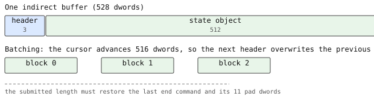

# Graphics Submission

This chapter defines what a graphics submission contains and what the command
processor must observe for the draw to complete.  The ring and command-word
vocabulary above the submission is described in [the command
interface](interface.md); this chapter covers the payload and its ordering
rules.

## One submission is one indirect buffer

A draw is submitted as an indirect buffer: a GPU virtual address and a length
in bytes.  The buffer holds an *envelope* whose payload is the 512-dword state
object.  There is no separate draw command — a state object that passes the
command processor **is** the draw.

```text
IB dword 0        0x00000f04     full-state header
IB dword 1        10             full-state header
IB dword 2        0x20000001     full-state header
IB dword 3..514   512 dwords     state object
IB dword 515      0x00000003     state terminator
IB dword 516      0x00000f05     end command
IB dword 517..527 zero           alignment of this form
```



The three header dwords are fixed values for this form.  Their individual
fields are not decoded: the value `0x20000001` is consistent with a 512-dword
range, but the encoding of the mode and range words is UNRESOLVED.

A state offset in this documentation is relative to the first dword of the
state object, so a packet byte offset is the state offset plus the 0x0c bytes of
the envelope header.

### Border-table preamble

When a draw uses border colours, a six-dword preamble is placed at the very
front of the indirect buffer, before the full-state header:

```text
0x000000a1  0x001a8000  0x00000008  0x00000f05  0x00000000  0x00000000
```

The two middle dwords are the low and high halves of the border table address
`0x00000008001a8000`.  The preamble is emitted once per command context, and it
must be the first block of the buffer: it cannot follow other state blocks.
With a preamble present the state header starts at dword 6 and the terminator
and end command shift accordingly.

## Batching several draws

Consecutive draws may share one indirect buffer.  Each block is laid down at the
full 528-dword size but the write cursor advances only 516 dwords, so the next
block's header overwrites the previous block's end command:

```text
block 0: header, state, 0x3, 0xf05, pads
block 1: header, state, 0x3, 0xf05, pads      (starts 516 dwords after block 0)
```

The submitted length must therefore restore the last block's end command and its
eleven pad dwords — twelve dwords beyond the last state block.  A submission
length without that tail leaves the graphics ring wedged.  With a border
preamble, the preamble's six dwords precede the first header and the tail is
adjusted the same way.

A batch capacity of 16 blocks with a ring of four indirect buffers is a working
configuration; the sizes are a host choice, not an architectural limit.

## Packets that are not state

Three packet families sit between state blocks.  They do not fit the fixed
528-dword block and cannot be batched with other draws:

| Purpose | Dwords | Placement |
|---------|--------|-----------|
| Query begin (reset) | `selector << 8 \| 0x0d` | at the front of the buffer |
| Query end (sample) | `0x00000003`, `selector << 8 \| 0x0c`, address low, address high | after the state terminator |
| Timestamp begin | `(1 << 8) \| 0x13`, address low, address high | at the front of the buffer |
| Timestamp end | `0x00000003`, `(0x200 << 8) \| 0x13`, address low, address high | before the end command; the second sample is written eight bytes past the first |
| Streamout end | `0x0200000c`, address low, address high, `0x00000016` | between the state terminator and the end command |

Query selectors are occlusion `0x400000`, primitives generated `0x2000` and
primitives emitted `0x20000`; the latter two are counted on the host rather than
by the GPU.  A timestamp packet must be closed by an explicit terminator and end
command pair, otherwise the completion fence never signals.

## Completion

A submission carries a fence: a buffer whose first dword receives the kernel's
completion sequence number, plus a sync object for waiting.

* A wait first checks the fence word directly and only then falls back to the
  sync object, so a completed submission costs no system call.
* A zero timeout means "poll once" and never blocks.
* The fallback path waits on the sync object with an absolute deadline and, when
  the sync object is unavailable, queries the fence status directly.
* A half-second timeout is a working default for a batch.
* A timeout is not a retry: the context is marked lost, the kernel is asked
  whether a reset was observed, and the context is rebuilt only when a reset is
  actually reported.

Sync objects follow the usual binary and timeline rules: timeline waits may be
submitted ahead of the signal, binary waits and signals must carry point zero,
and every submission appends its own fence as the last signal in the chain.
Submissions are serialised against the previous submission's fence unless the
host explicitly overrides the dependency.

## Memory and residency

* Every address in a submission is a GPU virtual address.  A host allocation
  handle is never a packet field.
* Addresses come from kernel virtual-address ranges.  One range is bound to one
  buffer range at a time, ranges are handed out monotonically and are not
  recycled, and the default base of the graphics range is `0x100000000`.
* The map granularity is 16 KiB.  An indirect buffer must be mapped executable;
  data resources are mapped readable and writable.
* A submission lists its resident buffers.  Duplicate buffers are collapsed, and
  a submission with more than 160 distinct buffers is rejected rather than split
  — a host must split its own submissions.
* Buffers that a submission reads or writes must stay resident until its fence
  signals.  There is no user-pointer path; a buffer enters the GPU through an
  imported handle.

Cache maintenance is implicit in this model: there is no flush or invalidate
packet.  A CPU read of GPU-written memory happens after the fence, and a CPU
write becomes visible to the GPU by the ordering of the submission that consumes
it.  Write-combined mappings are used for host-written resources.

## Ordering and reuse rules

1. An indirect buffer must be mapped executable before it is submitted.
2. The submitted length must be a multiple of four bytes, and a buffer cannot be
   smaller than the map granularity.
3. Restore the last block's end command and its pad dwords in the length.
4. A render target written earlier in the same batch must be flushed before it
   is sampled.
5. An indirect buffer slot cannot be reused while a submission that reads it is
   in flight.
6. A per-draw argument area cannot be reused until the submission that owns it
   has signalled.
7. A texture-binding change cannot be carried across state records by reuse: the
   descriptor root must be re-read, either by emitting the border preamble again
   or by flushing.
8. Draws that need a synchronised result — blit clears, transform-feedback
   expansion, compacted vertex expansion, index-buffer user memory, border
   locks, or a query packet — are submitted standalone and waited on.

## Limits and alignment

| Property | Value |
|----------|-------|
| Indirect-buffer capacity | 16 blocks of 528 dwords |
| Indirect-buffer ring | 4 buffers |
| Resident buffers per submission | 160 |
| Argument slot stride | 0x3a20 bytes, 128 slots |
| Query buffer size | 0x4000 bytes |
| Map granularity | 16 KiB |
| Multisample resource alignment | 1 MiB |
| Cube resource alignment | 16 KiB |
| Fence timeout | 500 ms |

## UNRESOLVED

* The names and semantics of the packet opcodes used by the envelope and the
  preamble: `0xf04`, `0xf05`, `0xa1`, `0x04` and `0x05` are emitted as fixed
  constants and are not part of the documented stream-command vocabulary.
* The meaning of the full-state header's mode and range words.
* Whether the outer ring must wrap a submission in a virtual-memory identifier
  and an indirect-buffer command, or whether the payload can be placed on the
  ring directly; only the indirect-buffer form is established here.
* The ip-type, ip-instance and ring selectors of a submission: a graphics
  submission uses ip-type 0 with the remaining selectors zero, and the legal
  range of those selectors is not established.
* Interrupt routing and the kernel ioctl contract are outside this document.
