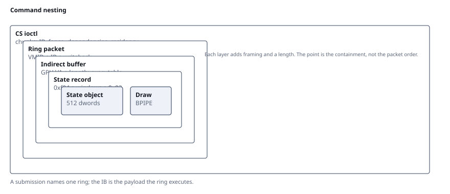

# Indirect Buffers

A graphics submission is an indirect buffer: a GPU virtual address and a length
in bytes. The buffer contains an envelope, the state record and, for a batched
submission, several state records. This chapter defines the container. The
record grammar is in [State records](../graphics/state-records.md) and the state
fields are in [State object](../graphics/state-object.md).



The figure shows the containment of a submission, a ring packet, an indirect
buffer, a state record and the draw payload.

## Full-state envelope

The common form is 528 dwords:

| Dword | Content |
|------:|---------|
| 0 | `0x0000_0f04`: state-record opcode. |
| 1 | `10`: full-state mode. |
| 2 | `0x2000_0001`: window descriptor, start 0 and length 512. |
| 3–514 | The 512-dword state object. |
| 515 | `0x0000_0003`: state terminator. |
| 516 | `0x0000_0f05`: end command. |
| 517–527 | Zero padding. |

The three header dwords are the state-record header; dword 2 is a window
descriptor, not an opaque value. The state object starts at dword 3, so a state
offset is relative to that dword, and the packet byte offset is the state offset
plus 12.

## Batching

Consecutive draws may share one indirect buffer. Each block is laid out at the
full 528-dword size, but the write cursor advances by 516 dwords, so the next
block's header overwrites the previous block's end command:

```text
block 0: header, state, 0x3, 0xf05, pads
block 1: header, state, 0x3, 0xf05, pads
```

The submitted length MUST restore the last block's end command and its eleven
pad dwords: twelve dwords beyond the last state block. A length without that
tail leaves the graphics ring waiting for an end that never arrives.

A batch capacity of 16 blocks and a ring of four indirect buffers is a working
configuration; both are host choices, not architectural limits.

## Border-table preamble

When a draw uses border colours, a six-dword preamble precedes the first state
record:

| Dword | Content |
|------:|---------|
| 0 | `0x0000_00a1` |
| 1 | Border-table address, low 32 bits: `0x001a_8000` |
| 2 | Border-table address, high 32 bits: `0x0000_0008` |
| 3 | `0x0000_0f05` |
| 4 | Zero |
| 5 | Zero |

The preamble MUST be the first block of the buffer. With a preamble present, the
first state header starts at dword 6 and the terminator and end command shift
accordingly. The preamble is emitted once per command context.

## Packets outside a state record

Three packet families sit between state records. They do not fit the fixed
528-dword block and cannot be batched with a draw.

| Purpose | Packet | Placement |
|---------|--------|-----------|
| Query begin | `(selector << 8) OR 0x0d` | Front of the buffer. |
| Query end | `0x3`, `(selector << 8) OR 0x0c`, address low, address high | After the state terminator. |
| Timestamp begin | `(1 << 8) OR 0x13`, address low, address high | Front of the buffer. |
| Timestamp end | `0x3`, `(0x200 << 8) OR 0x13`, address low, address high | Before the end command; the second sample is eight bytes past the first. |
| Streamout end | `0x0200_000c`, address low, address high, `0x16` | Between the state terminator and the end command. |

Query selectors are occlusion `0x400000`, primitives generated `0x2000` and
primitives emitted `0x20000`. A timestamp packet MUST be closed by a terminator
and an end command; otherwise the completion fence never signals.

## Alignment and limits

An indirect buffer MUST be mapped executable. Its start MUST be 32-byte aligned
for GPIPE, BPIPE and the display pipes, and 64-byte aligned for CPIPE. Its length
MUST be a multiple of four bytes and no larger than `0x00ff_ffff` dwords.

## Open questions

- The meaning of the full-state mode word beyond the value 10.
- Whether a state record may start at a non-zero window for the first draw of a
  context.
- The exact packet opcodes for the query and timestamp forms outside the values
  listed here.
