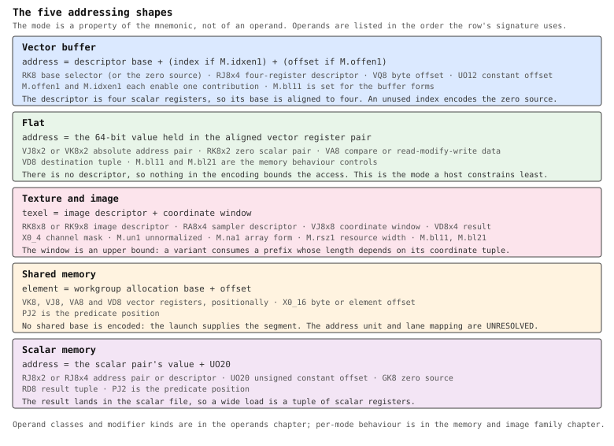

# Memory and Image Family

The instruction index for this family is under [memory-image](../instructions/memory-image.md).

The memory and image family moves data between memory and the vector and scalar
register files.  Operand classes and the five addressing shapes are defined in
[Operands and Execution Registers](operands.md#addressing-families); this
chapter describes what the shapes mean and how the forms differ.

## Addressing modes

Four addressing modes exist, and the mode is a property of the mnemonic rather
than an operand:

| Mode | Address comes from | Typical use |
|------|--------------------|-------------|
| Vector buffer | a 16-byte buffer descriptor plus an offset and an optional index | uniform and storage buffers, vertex attributes, formatted loads |
| Flat | an absolute 64-bit address held in a register pair | generic pointers, images without a descriptor |
| Image | an image descriptor plus a coordinate window | texture fetch and store, image loads and stores |
| Shared memory | an offset relative to the workgroup's allocation | workgroup communication, interpolation coefficients |

Scalar forms of the buffer and flat modes exist for the scalar register file, so
five operand shapes occur in the encoding.  There is no scalar image mode.



## Buffer addressing

```text
address = descriptor base
        + (index register value when the index form is enabled)
        + (constant offset when the offset form is enabled)
```

The descriptor is four scalar registers, so the encoded base is aligned to four.
The index operand is a vector register holding a byte offset, and the constant
offset is an unsigned field in the instruction.  Forms that do not use an index
encode the architectural zero source in its place, and forms that do not use a
constant offset encode zero.

The descriptor's byte-extent field bounds the access.  It applies to loads; a
store is not range-checked by that field, so a host must keep stores inside the
backing allocation itself.

## Flat addressing

The address is an absolute 64-bit value in an aligned vector register pair; the
scalar pair position holds the architectural zero source, because there is no
descriptor.  A flat access is therefore not bounded by any descriptor, and it is
the mode with the fewest constraints a host can impose.

## Image addressing

An image access takes an eight-scalar-register image descriptor and a window of
vector registers holding the coordinate tuple.  The window is an upper bound:
the number of registers a form consumes depends on its coordinate tuple, which
depends on the image type — two coordinates for a 2D image, an extra layer for an
array, an extra coordinate for a volume, and a direction vector for a cube.

The image descriptor supplies the base address, dimensions, format, type, layout
and mip bounds; the surface records described in
[Descriptors](../shader/descriptors.md) explain the fields.

## Format conversion

Three kinds of load exist:

* **Typed loads** (`load_v_buff_u8`, `load_v_flat_b64`, …) fetch a fixed
  element width and sign-extend or zero-extend it.
* **Formatted loads** (`*_fmtdesc_*` and `*_fmtinst_*`) convert through a format
  description attached to the buffer rather than through the instruction.  Both
  forms exist because the conversion can be described either by a descriptor
  bound to the resource or by the instruction's own encoded format; which one a
  driver uses depends on whether the format varies per resource.
* **Packed image loads** (`load_v_tex_pck`, `load_v_tex_mip_pck`) convert the
  resource representation to the destination representation during the fetch;
  the signed variant preserves signed component interpretation.  The exact
  numeric mapping per format pair is UNRESOLVED.

Stores come in the fixed-width and formatted kinds; there is no signed packed
store form, only a packed one.

## Sub-word access

An 8- or 16-bit buffer access reads or writes an element narrower than a register.
**The operand form IS established (2026-10-13)** - it is the layout: `load_v_buff_i8`
and `_u8` carry `RK8`, `RJ8x4`, the destination `VD8`, `UO12` and the enable/modifier
bits and **no index operand at all**, while the 16-bit loads and the 8-bit store name
one (`VQ8` on the loads, `RA8` on the store).  The extension rules are stated on the
rows as well: the byte becomes `0xffffff80` from `0x80` and `0x00000080` for the
unsigned sibling, and the halfword likewise.

So what is actually missing is not the form but **hardware verification**: the carrier
cannot stage a buffer descriptor, so no sub-word buffer access has ever been executed
and compared.  A driver should still avoid them or verify them first - but the reason
is the missing execution, not a missing description.

## Shared memory

Shared-memory instructions address the workgroup allocation with an offset
operand, and move between that memory and registers:

* Loads and stores of 8, 16, 32 and 64 bits, with an explicit offset.
* A coefficient load used by the fragment interpolation path, which reads one
  coefficient vector from a base register plus a slot index.
* Matrix forms — `load_sm_matrix_x1`, `x2` and `x4` — that read one, two or four
  planes.  The single-plane form reads element `n` of a four-column matrix into
  lane `n`, with the row pitch taken from the caller's per-lane address stride
  rather than from each lane's own address; the encoded destination byte is the
  tuple start and must be aligned to the tuple width.  The mapping of the planes
  onto registers in the multi-plane forms, and the intra-plane layout, are
  UNRESOLVED; `x4` was measured to write more than four registers.
* Swizzle forms that load or store a 64-bit element with a permutation, where the
  unit of the offset, the permutation's action on address versus data, and
  whether it is an involution are UNRESOLVED.

The launch record carries an LDS size field, but every established path leaves
it zero, so the allocation size is not communicated through it.

## Atomics

Atomics perform a read-modify-write on a memory location and return the previous
value; a compare-and-swap form additionally conditions the write on a comparison.
Three memory spaces have atomic families — shared memory, buffer and flat — and
the image family has its own atomic forms that address through an image
descriptor.

The operations are add, subtract, reverse-subtract, and, or, xor, increment,
decrement, minimum, maximum and swap, over signed and unsigned 32- and 64-bit
integers, plus floating-point minimum, maximum and compare-and-swap forms.

Two properties matter for a driver: a scalar offset or an index operand bounds
which location is touched, and several lanes of one instruction can target the
same location, in which case the result of the whole instruction is the
lane-order accumulation rather than a single value per lane.  The exact
serialisation between lanes, and the ordering with respect to other instructions
in the same invocation, is UNRESOLVED.

## Family map

| Form | Addressing | Notes |
|------|-----------|-------|
| `load_v_buff_*`, `store_v_buff_*` | vector buffer | fixed and formatted widths |
| `load_v_flat_*`, `store_v_flat_*` | flat | absolute address pair |
| `load_s_buff_*`, `load_s_flat_*` | scalar buffer and flat | result lands in scalar registers |
| `load_v_tex*`, `store_v_tex*` | image | fetch and store, optionally packed and with an explicit level |
| `load_sm_*`, `store_sm_*` | shared memory | plus coefficient, matrix and swizzle forms |
| `atomic_sm_*`, `atomic_v_buff_*`, `atomic_v_flat_*`, `atomic_v_tex_*` | the four spaces | read-modify-write |
| `getlod`, `getresinfo` | image | query the level and the resource shape |
