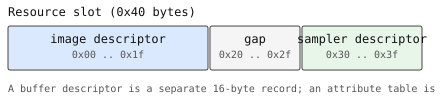

# Descriptors

A descriptor is a fixed-size record in GPU memory that describes one resource.
Shader-info *roots* point at descriptor memory; descriptors point at payload.
The shader never sees a host handle.

## Binding slots

Resources are bound in 0x40-byte slots.  A slot holds one image descriptor in
its first eight dwords, a zero-filled gap, and one sampler descriptor in the
last four dwords:

| Slot offset | Size | Content |
|------------:|-----:|---------|
| `+0x00` | 0x20 | Image descriptor (8 dwords) |
| `+0x20` | 0x10 | Not part of a descriptor |
| `+0x30` | 0x10 | Sampler descriptor (4 dwords) |



Buffers are bound in 16-byte records.  An attribute table is a contiguous array
of those same 16-byte records, one per vertex element.

| Binding | Record | Tuple | Where the root points |
|---------|--------|-------|----------------------|
| Buffer (uniform, storage, constant, streamout) | 16 bytes | four SGPRs | a descriptor-table entry |
| Image | 32 bytes | eight SGPRs | the image descriptor field of a slot |
| Sampler | 16 bytes | four SGPRs | the sampler descriptor field of a slot |
| Attribute | 16 bytes per element | four SGPRs | an array of element records |

Bound slots may be packed: the logical unit numbers used by the API are
compacted into physical slot indices in ascending order of first use.

## Buffer descriptor

16 bytes, four dwords.

| Bits | Field | Meaning |
|-----:|-------|---------|
| `[47:0]` | Base address | GPU VA of the payload |
| `[61:48]` | Stride | 14-bit element stride; zero for uniform, storage, constant and streamout bindings, the vertex stride for attribute records |
| `[62]` | Cache swizzle | not used |
| `[63]` | Swizzle enable | not used |
| `[95:64]` | Byte size | byte count of the accessible range, not an element count |
| `[98:96]` | Destination select X | 3-bit channel selector |
| `[101:99]` | Destination select Y | |
| `[104:102]` | Destination select Z | |
| `[107:105]` | Destination select W | |
| `[110:108]` | Number format | see [Number formats](#number-formats) |
| `[114:111]` | Data format | see [Buffer data formats](#buffer-data-formats) |
| `[116:115]` | Element size | not used |
| `[118:117]` | Index stride | not used |
| `[119]` | Add thread id | not used |
| `[120]` | ATC | not used |
| `[121]` | Hash enable | not used |
| `[122]` | Heap | not used |
| `[125:123]` | Memory type | not used |
| `[127:126]` | Type | not used |

| Dword | Content |
|------:|---------|
| 0 | base address in bits `[47:0]`, stride in `[61:48]`, the two unused flag bits above it |
| 1 | byte size |
| 2 | channel selects in `[11:0]`, number format in `[14:12]`, data format in `[18:15]`, the unused control fields above them |

A descriptor for an absent resource still has to be well formed: keep the same
shape and point the base at a zeroed range large enough for any access the
shader can make.

## Image descriptor

32 bytes, eight dwords.

| Bits | Field | Meaning |
|-----:|-------|---------|
| `[39:0]` | Base address | GPU VA of the image payload |
| `[51:40]` | Minimum LOD | not used |
| `[57:52]` | Data format | see [Image data formats](#image-data-formats) |
| `[61:58]` | Number format | see [Number formats](#number-formats) |
| `[63:62]` | Memory type low | not used |
| `[77:64]` | Width | 14-bit extent of the base level |
| `[91:78]` | Height | 14-bit extent of the base level |
| `[94:92]` | Performance mode | producers write different values; the encoding is UNRESOLVED |
| `[95]` | Interlaced | not used |
| `[98:96]` | Destination select X | 3-bit channel selector |
| `[101:99]` | Destination select Y | |
| `[104:102]` | Destination select Z | |
| `[107:105]` | Destination select W | |
| `[111:108]` | Base level | 4-bit mip index bound |
| `[115:112]` | Last level | 4-bit mip index bound; for a 4x multisample image this is the base-2 logarithm of the sample count |
| `[120:116]` | Tiling index | 0 = linear, 2 = tile2 |
| `[121]` | Power of two pad | set for a padded layout |
| `[122]` | Memory type high | not used |
| `[123]` | Texture flip Y | not used |
| `[127:124]` | Type | see [Image types](#image-types) |
| `[140:128]` | Depth | 13-bit extent of the base level |
| `[154:141]` | Pitch | 14-bit span of one row **in elements** |
| `[172:160]` | Base array | 13-bit first layer |
| `[185:173]` | Last array | 13-bit last layer |
| `[203:192]` | Minimum LOD warning | not used |
| `[211:204]` | Counter bank id | not used |
| `[212]` | LOD hardware count enable | not used |
| `[213]` | Compression enable | not used |
| `[214]` | Alpha is MSB | not used |
| `[215]` | Color transform | not used |
| `[219:216]` | Lost alpha bits | not used |
| `[223:220]` | Lost color bits | not used |
| `[255:224]` | — | no fields |

| Dword | Content |
|------:|---------|
| 0 | base address `[39:0]` |
| 1 | minimum LOD `[11:0]`, data format `[25:20]`, number format `[29:26]`, memory type low `[31:30]` |
| 2 | width `[13:0]`, height `[27:14]`, performance mode `[30:28]`, interlaced `[31]` |
| 3 | channel selects `[11:0]`, base level `[15:12]`, last level `[19:16]`, tiling `[24:20]`, power-of-two pad `[25]`, memory type high `[26]`, flip Y `[27]`, type `[31:28]` |
| 4 | depth `[12:0]`, pitch `[26:13]` |
| 5 | base array `[12:0]`, last array `[25:13]` |
| 6 | the unused warning, compression and colour fields |
| 7 | no fields |

Two shapes are legal, and they differ in how mip levels are addressed:

* **Non-array images** carry a single level.  The base address already includes
  that level's offset, base level is 0, and last level is the number of levels
  minus one.
* **Array and cube images** keep the full mip chain: base and last level span
  the chain the view selects, the base address is not level-adjusted, and the
  layer is reached through the array stride.

Packing must reject a descriptor whose pitch is zero, whose base level is
greater than its last level, whose base array is greater than its last array, or
whose last array exceeds the field width.

## Sampler descriptor

16 bytes, four dwords.

| Bits | Field | Values |
|-----:|-------|--------|
| `[2:0]` | Clamp X | repeat, mirror repeat, edge, mirror edge, border |
| `[5:3]` | Clamp Y | same |
| `[8:6]` | Clamp Z | same |
| `[11:9]` | Maximum anisotropy ratio | base-2 logarithm of the ratio |
| `[14:12]` | Depth compare function | never, less, equal, less-equal, greater, not-equal, greater-equal, always |
| `[15]` | Force unnormalized | unnormalized (texel) coordinates |
| `[18:16]` | Anisotropy threshold | not used |
| `[19]` | Coordinate truncate | not used |
| `[20]` | Force degamma | not used |
| `[26:21]` | Anisotropy bias | not used |
| `[27]` | Truncate coordinates | not used |
| `[30:29]` | Filter mode | not used |
| `[31]` | Compatibility mode | not used |
| `[43:32]` | Minimum LOD | unsigned 8.8 fixed point |
| `[55:44]` | Maximum LOD | unsigned 8.8 fixed point |
| `[59:56]` | Performance mip | not used |
| `[63:60]` | Performance Z | not used |
| `[77:64]` | LOD bias | signed 8.8 fixed point in a 14-bit field |
| `[83:78]` | Secondary LOD bias | not used |
| `[85:84]` | Magnification filter | nearest, linear |
| `[87:86]` | Minification filter | nearest, linear |
| `[89:88]` | Z filter | not used |
| `[91:90]` | Mip filter | none, nearest, linear |
| `[92]` | Mip point preclamp | not used |
| `[93]` | Disable LSB ceil | not used |
| `[94]` | Filter precision fix | not used |
| `[95]` | Anisotropy override | set when the ratio is greater than one |
| `[107:96]` | Border color pointer | 12-bit index into the border table |
| `[124:108]` | — | unnamed reserved field |
| `[125]` | Upgraded depth | not used |
| `[127:126]` | Border color type | table entry |

The LOD fields are 8.8 fixed point and only express 0 to about 16, so a host
must clamp a wider range before packing.  A sampler whose mip filter is "none"
behaves as a single-level sampler: write zero minimum and maximum LOD and select
the nearest mip filter.

Anisotropic filtering is encoded but inert: the ratio and override bits are
packed and the API advertises the capability, while sampling stays isotropic.
The exact meaning of the anisotropy fields is UNRESOLVED.

### Border color

Border colors live in a fixed 0x10000-byte table at GPU address
`0x00000008001a8000`.  Each entry is 32 bytes: the first 16 bytes are a float4
that the hardware does not read, and bytes 16..31 hold the sampled texel in the
image format.  The sampler's pointer field is in 8-byte units and consecutive
entries are four units apart.

The border table is announced to the command processor by a six-dword preamble
at the very front of an IB, once per context:

```text
0x000000a1  0x001a8000  0x00000008  0x00000f05  0x00000000  0x00000000
```

## Attribute descriptors

An attribute descriptor is a buffer descriptor whose base, stride and byte size
describe one vertex element:

| Field | Attribute meaning |
|-------|-------------------|
| Base address | vertex buffer address plus the element offset |
| Stride | distance between consecutive vertices |
| Byte size | readable extent from the base |
| Data / number format | element format |

There are at most 16 attributes, stored as a contiguous array of 16-byte
records.  Dual-slot elements, where one element is fed from two buffers, are not
supported.

Some formats have no direct element tuple, for example a packed `10_10_10_2`
attribute.  Those are fetched as a raw 32-bit element and unpacked in the
shader.

## Enumerations

### Color hardware formats

| Value | Format | Value | Format | Value | Format |
|------:|--------|------:|--------|------:|--------|
| 0 | RGBA8 | 2 | RGBA16 float | 3 | RGBA32 float |
| 4 | RGBA8 SINT | 5 | RGBA16 SINT | 6 | RGBA32 SINT |
| 7 | RGBA8 UINT | 8 | RGBA16 UINT | 9 | RGBA32 UINT |
| 10 | RG8 | 12 | RG16 float | 13 | RG32 float |
| 14 | RG8 SINT | 15 | RG16 SINT | 16 | RG32 SINT |
| 17 | RG8 UINT | 18 | RG16 UINT | 19 | RG32 UINT |
| 20 | R8 | 22 | R16 float | 23 | R32 float |
| 24 | R8 SINT | 25 | R16 SINT | 26 | R32 SINT |
| 27 | R8 UINT | 28 | R16 UINT | 29 | R32 UINT |
| 32 | R11G11B10 float | 35 | RGBA8 sRGB | 44 | RGB10A2 |

Unassigned values are not usable.  Unorm, snorm and integer elements share a
carrier when the hardware format is unsuffixed: R16_UNORM, R16_SNORM and
R16_UINT all live on hardware format 28, and the interpretation comes from the
number format and the element format.

### Depth hardware formats

| Value | Format |
|------:|--------|
| 37 | Z24 |
| 38 | Z32 float |
| 39 | Z24 + stencil 8 |
| 40 | Z32 float + stencil 8 |

Z16 carriers are stored on the Z32 float format.

### Image data formats

| Value | Format | Value | Format | Value | Format |
|------:|--------|------:|--------|------:|--------|
| 1 | R8 | 2 | R16 | 3 | RG8 |
| 4 | R32 | 5 | RG16 | 6 | R11G11B10 |
| 9 | RGB10A2 | 10 | RGBA8 | 11 | RG32 |
| 12 | RGBA16 | 13 | RGB32 | 14 | RGBA32 |
| 21 | depth | 34 | RGB9E5 | 38 | RGTC1 |
| 39 | RGTC2 | | | | |

### Buffer data formats

| Value | Format | Value | Format |
|------:|--------|------:|--------|
| 1 | R8 | 2 | R16 |
| 3 | RG8 | 4 | R32 |
| 5 | RG16 | 10 | RGBA8 |
| 11 | RG32 | 12 | RGBA16 |
| 13 | RGB32 | 14 | RGBA32 |

### Number formats

| Value | Format | Value | Format |
|------:|--------|------:|--------|
| 0 | UNORM | 1 | SNORM |
| 4 | UINT | 5 | SINT |
| 7 | float | 9 | sRGB |

### Image types

| Value | Type | Value | Type |
|------:|------|------:|------|
| 8 | 1D | 9 | 2D |
| 10 | 3D | 11 | cube |
| 12 | 1D array | 13 | 2D array |
| 14 | 2D multisample | 15 | 2D multisample array |

### Surface types

| Value | Type |
|------:|------|
| 0 | 2D |
| 2 | 2D mip level |
| 4 | layered |
| 6 | layered mip level |
| 8 | 2D multisample |
| 12 | 2D multisample array |

There is no separate 1D, 3D or cube surface type.

### Descriptor channels

| Value | Channel |
|------:|---------|
| 0 | zero |
| 1 | one |
| 4..7 | X, Y, Z, W |

## Layout and tiling

Two layouts exist: linear (tiling index 0) and tile2 (tiling index 2).  No other
value is used.

Tile2 arranges a level as 4x4 blocks in Morton order:

```text
row_elements = row_stride / block_size
tile         = (y >> 2) * (row_elements >> 2) + (x >> 2)
intra        = ((y & 2) << 2) | ((x & 2) << 1) | ((y & 1) << 1) | (x & 1)
offset       = (tile * 16 + intra) * block_size
```

Rules a host must follow:

* A level's row pitch is the next power of two at or above the level width, with
  a minimum row of 256 bytes for tiled render targets and 3D volumes.
* Physical width is padded to eight elements and physical height to four rows
  for a multi-level chain; level storage is aligned to 256 bytes.
* Array and cube images keep the chain in one allocation: each level is
  256-byte aligned and the level sizes accumulate into the array stride.
* Block-compressed images are always linear, with one padded stride carried
  across the chain.
* Linear 2D images use a power-of-two row pitch with a 64-element floor.
* The descriptor carries no slice stride: a 3D volume's slice step is the level
  pitch times the logical height.
* Colour and depth surfaces share the record shape; multisample depth storage
  uses its own interleaved sample order.

## Multisampling

Only 4x multisampling exists.  The sample count is **not** stored in a surface
record and is not implied by the surface type: surface type 8 covers both 2x and
4x, and 4x is signalled by the MSAA enable bit in
[Pipe Enables](../graphics/state-object.md).

A 4x image is described with image type 14 or 15 and a last level of
`log2(samples) = 2`.  Multisample colour attachments are cleared through a CPU
mapping; a 4x colour resolve runs as a GPU pass that reads the sample plane,
while depth and stencil resolve run through CPU transfers.

## Sampling path

* Explicit-LOD sampling does not reach the sampler's LOD ladder: the shader
  computes the level and fetches with the mip-load form, scaling normalised
  coordinates to texel coordinates for the chosen level.
* Implicit sampling derives the level from quad derivatives inside the texture
  unit; the shader supplies no derivatives for it.
* The sampler minimum and maximum LOD and the LOD bias are applied by the shader
  for explicit fetches and by the texture unit for implicit ones.
* Array and cube descriptors keep the original mip indices, so the LOD domain is
  offset by the view's first level.
* Gather uses the channel mask to select the component; the offset is a pair of
  signed fields packed into two bytes, with a range of -8..7 for sampling and
  -32..31 for gather.
* Depth comparison sampling requires the sampler's depth compare function and
  returns the comparison result as a scalar.
* Cube maps are described as layered 2D images; there is no separate cube-array
  layer selection.

## Limits

| Limit | Value |
|-------|-------|
| Sampler descriptors per shader | 16 |
| Texture units and bindings | 17 |
| Vertex elements / vertex buffers | 16 / 16 |
| Uniform buffer bindings | 12 |
| Render targets | 8 |
| Array layers | 256 |
| Mip levels | 16 |
| Buffer stride field | 14 bits, below 0x4000 |
| Buffer base address field | 48 bits |
| Image base address field | 40 bits |
| Push constants | 256 bytes |

## UNRESOLVED

* The performance mode field: producers write different values for the same
  resource shape.
* The 12-bit colour buffer swizzle: only the constant written per format is
  known, not the meaning of its subfields.
* Buffer descriptor bits `[63:62]` and `[127:119]`: element size, index
  stride, thread id, ATC, hash, heap, memory type and type.
* Image descriptor minimum LOD, performance mode, interlaced, flip Y, memory
  type, warning, counter bank, LOD count, compression, alpha-is-MSB, colour
  transform and the lost-bit fields.
* Surface types 2 and 6: when a producer emits them for a mip-mapped attachment
  is not established.
* Whether the tile2 alignment rules are a hardware requirement or a producer
  convention, and whether tiling values other than 0 and 2 exist.
* The border table addressing unit.
* Where the 4x depth sample order and the depth resolve layout come from.
