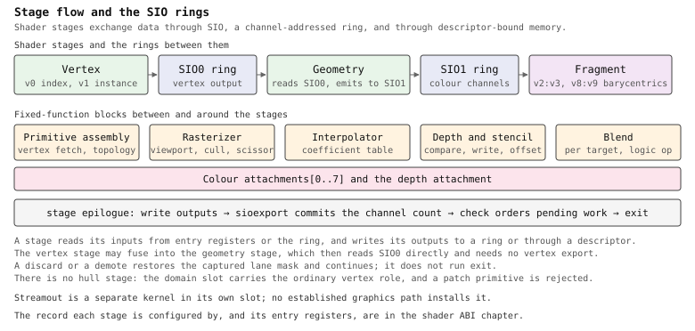

# Stage Interfaces

This chapter is the practical half of the [Shader ABI](abi.md): what a stage
finds in its registers at entry, what it must export, and which state records
must agree with it.  Record fields are in [Shader ABI](abi.md) and
[The State Object](../graphics/state-object.md); the registers a launch supplies
are in [Registers and Allocation](registers.md).



## Common shape

Every stage starts at `kernel_entry` with the launch registers of its role, and
every stage ends in the same order:

```text
1. export outputs             (SIO writes)
2. commit the export          (sioexport with the channel count)
3. order pending work         (check)
4. terminate                  (exit)
```

A stage must capture the active lane mask before it clobbers anything, because
the mask has to be restored at exits that are not terminations, such as a
discard.  A stage that uses per-quad helper lanes installs a full-quad mask
after that capture.

## Vertex

Runs in the domain slot with the DS-as-vertex bit set and shader type 3.

| Register | Contents |
|----------|----------|
| `v0` | vertex index, with the draw's vertex offset already applied |
| `v1` | instance identifier |
| `s4:s5` | constant root |
| `s6:s7` | image and sampler descriptor root |
| `s8:s9` | attribute descriptor table |

Reading an attribute: load the 16-byte descriptor for the element at
`slot * 16` from the table, then fetch through the buffer addressing form using
that descriptor.  The table has 16 entries, so an attribute ordinal of 16 or
more must be rejected or replaced by a constant zero.

Exporting: write the position record to stream SIO0 at offset `0x0000`, then
each varying record after it, and finally export the total channel count.  The
export count must equal the position channels plus the varying channels.

When a geometry stage consumes this stage's output directly, the export is
omitted and the geometry stage reads the ring instead.

## Fragment

| Register | Contents |
|----------|----------|
| `s4:s5` | constant root |
| `s6:s7` | image and sampler descriptor root |
| `s9` | base of the interpolation coefficient table |
| `v2:v3` | barycentric pair, smooth |
| `v8:v9` | barycentric pair, noperspective |
| `v0:v1` | barycentric pair when a sample mask is used |
| `v12..v15` | fragment coordinate |
| `v6` | coverage or sample mask |
| `v12` or `v16` | front-facing flag |

Interpolation recipe: read the varying's coefficient from the coefficient table
with the shared-memory interpolation load, using slot
`base * 4 + channel + component`, then combine it with the barycentric value.
Flat interpolation takes the provoking-vertex value directly instead of
interpolating.

Export: colour target *n* starts at channel slot `channels << 7`, where
`channels` counts the channels of the preceding targets.  A target contributes
two channels for a 16-bit format, four for a 32-bit format and one for a packed
integer format.  A written depth value occupies channel slot 0.  The export
count is the total colour channels plus one when depth is written, and a
fragment stage that writes nothing still exports one channel.

The fragment input configuration must agree with the program: its address field
selects where the input window starts and its enable field selects which input
groups are delivered (smooth or flat, noperspective, fragment coordinate, face).
The interpolation coefficient count must cover the coefficient vectors the
program reads, and is at least five when a geometry stage precedes it.

## Geometry

Runs in the geometry slot with shader type 4.

| Register | Contents |
|----------|----------|
| `v0` | packed input-vertex selectors, six 5-bit fields |
| `v1` | primitive identifier |
| `s4:s5` | constant root |
| `s6:s7` | image and sampler descriptor root |

Input data is read from SIO0 in ordered four-channel transfers. Generic
varyings follow the producer's entire position and distance payload. The
producer and consumer must use the same linked input layout and window width.

Output payloads are staged into SIO1 before each emit; the separator and
emitted-vertex count are maintained independently of the primitive opcode.
`v_emit2` is used for points and lines, and `v_emit3` for triangles. The header
is updated before the final export. Window maintenance must preserve the
constant root in `s4:s5`, including across later UBO loads.

The formulas, register choices, driver defaults, and unresolved shapes are in
[Geometry Stage](geometry.md). There is no vertex attribute descriptor table
for this stage: its inputs are ring channels.

## Streamout

A streamout stage is a separate kernel in slot 4 with shader type 6, a vector
register size of 2, a vector initial count of 2 and a tail value of `0x20`.  Its
record capacity is passed as argument 2 and its read-write buffer root points at
the table it uses.

The kernel reads the destination descriptor and a control pair — a record count
and a stride in bytes — from its root, then stores each record through the
descriptor.

No established path installs a streamout stage; transform feedback is written
directly by the vertex or geometry stage.  The contract above is therefore
UNRESOLVED in hardware.

## Tessellation

There is no hull stage.  The domain slot carries the ordinary vertex role, and a
patch primitive is rejected before any state is built.  A host must therefore
expose no tessellation feature.

## Consistency checklist

A stage is valid only when these agree:

| Item | Must match |
|------|------------|
| Shader-info size fields | what the program actually uses |
| Code size | the uploaded binary length |
| Kernel entry | the first instruction of the binary |
| Export channel count | the channels the stage produced |
| Fragment attribute map | the producer's output ordinals |
| Fragment input configuration | the inputs the program reads |
| Interpolation coefficient count | the coefficient vectors the program reads |
| Stage config records | the stage topology actually enabled |
| Descriptor roots | the tables the program loads from |
