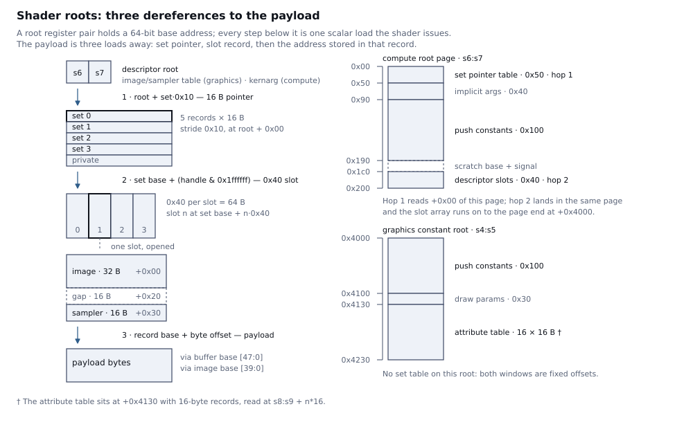

# Descriptors

A descriptor is a fixed-size record in GPU memory that describes a resource. A
shader-info root is a 64-bit base address, not a resource pointer. On the Vulkan
path the payload is three hops below it: a 16-byte set pointer, a 0x40-byte
slot, and the record's own base field. This chapter defines the record layouts,
the binding slots and the address rules.

The figure separates the pointer chain (root, set pointer, slot, record base) from
the fixed windows on the same page (push constants, implicit arguments, attribute
table).

## Binding slots

Images and samplers share a 0x40-byte slot:

| Offset | Size | Content |
|-------:|-----:|---------|
| `+0x00` | 32 | Image descriptor. |
| `+0x20` | 16 | Not part of a descriptor. |
| `+0x30` | 16 | Sampler descriptor. |

Buffers are bound in 16-byte records. An attribute table is a contiguous array
of the same 16-byte records.

| Binding | Record size | Tuple | Root |
|---------|------------:|-------|------|
| Buffer | 16 bytes | Four SGPRs | Descriptor table |
| Image | 32 bytes | Eight SGPRs | Image field of a slot |
| Sampler | 16 bytes | Four SGPRs | Sampler field of a slot |
| Attribute | 16 bytes per element | Four SGPRs | Attribute table |

## Buffer descriptor

| Bits | Field | Meaning |
|------|-------|---------|
| `[47:0]` | Base address | GPU virtual address of the payload. |
| `[61:48]` | Stride | Element stride; zero for uniform, storage, constant and streamout bindings. |
| `[62]` | Cache swizzle | Not used. |
| `[63]` | Swizzle enable | Not used. |
| `[95:64]` | Byte size | Accessible byte range. |
| `[98:96]` | Destination select X | Channel selector. |
| `[101:99]` | Destination select Y | Channel selector. |
| `[104:102]` | Destination select Z | Channel selector. |
| `[107:105]` | Destination select W | Channel selector. |
| `[110:108]` | Number format | UNORM, SNORM, UINT, SINT, float. |
| `[114:111]` | Data format | Element width and component count. |
| `[116:115]` | Element size | Not used. |
| `[118:117]` | Index stride | Not used. |
| `[119]` | Add thread id | Not used. |
| `[120]` | ATC | Not used. |
| `[121]` | Hash enable | Not used. |
| `[122]` | Heap | Not used. |
| `[125:123]` | Memory type | Not used. |
| `[127:126]` | Type | Not used. |

## Image descriptor

The image descriptor is 32 bytes. Its fields are in
[Texture and sampling](../graphics/texture.md#image-descriptor).

## Sampler descriptor

The sampler descriptor is 16 bytes. Its fields are in
[Texture and sampling](../graphics/texture.md#sampler-descriptor).

## Attribute descriptor

An attribute descriptor is a buffer descriptor whose base, stride and byte size
describe one vertex element:

| Field | Attribute meaning |
|-------|-------------------|
| Base address | Vertex buffer address plus the element offset. |
| Stride | Distance between consecutive vertices. |
| Byte size | Readable extent from the base. |
| Data and number format | Element format. |

There are 16 attribute records. Dual-slot elements are not supported.

## Roots and tables

| Root | Register | Layout |
|------|----------|--------|
| Constant (graphics) | `s4:s5` | Base of a page: push constants at `+0x4000`, draw parameters at `+0x4100`, attribute table at `+0x4130`. |
| Resource and sampler (Vulkan) | `s6:s7` | Base of a page: set-pointer table at `+0x00` (five 16-byte records, stride `0x10`), implicit arguments at `+0x50`, push constants at `+0x90`, descriptor slots at `+0x1c0` (0x40 bytes each). |
| Attributes | `s8:s9` | 16 records of 16 bytes; the compiler indexes `s8:s9 + slot * 16`. The driver writes the same table at `+0x4130`, but no code establishes that `+0x40` of the shader-info record hydrates it: UNRESOLVED. |
| Read-write buffer | — | No read-write root register is established. The streamout/read-write path is not modelled by these roots. |

The set-pointer hop exists on the Vulkan path. The direct graphics path uses the
slot at the root directly, which is the simpler three-level form in the figure's
left column.

## Push constants

On the graphics path, push constants occupy 256 bytes at `+0x4000` in the
constant root. The compute path has no constant root; its push constants are at
`+0x90` in the kernarg page rooted at `s6:s7`. The shader reads them with a
scalar flat load.

## Binding table packing

Bound slots may be packed: the logical binding numbers are compacted into
physical slot indices in ascending order of first use. A host MUST use the same
packing for the descriptor table and for the shader's slot arithmetic.

## Absent resources

A descriptor for an absent resource still has to be well formed. The current
path writes the same record shape and points the base at a zeroed range large
enough for any access the shader can make. A zero base is not a valid absent
descriptor; it is an address that faults.

## Alignment

| Object | Requirement |
|--------|-------------|
| Image descriptor tuple | Eight-SGPR aligned, at most 248. |
| Sampler descriptor tuple | Four-SGPR aligned, at most 252. |
| Texture destination | Four-VGPR aligned. |
| Channel mask | Nonzero. |

## Open questions

- Whether the descriptor table may be relocated per draw.
- The exact packing order when bindings are added out of order.
- Whether an absent descriptor may be all zero if the shader never reads it.
